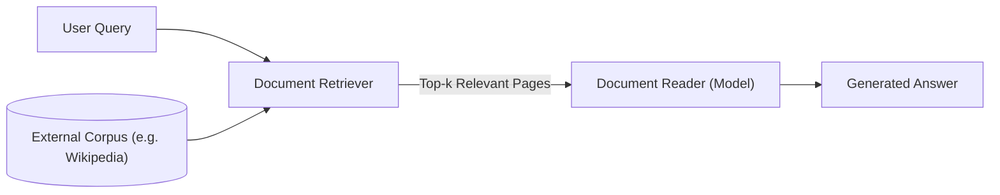
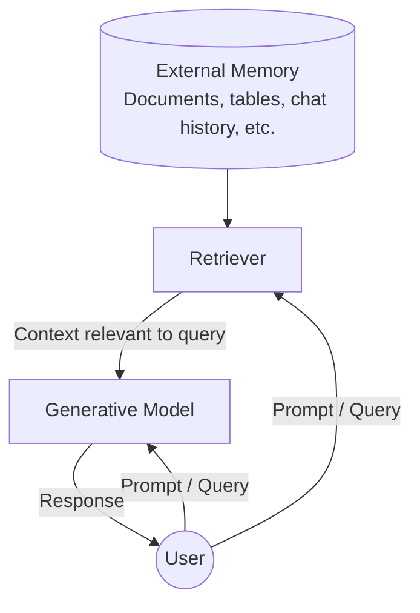

# الفصل 6 — الجزء 1: الـ RAG (`ص 253–275`)

> **ملاحظة:** هذه الملاحظات شرح تفصيلي صفحة بصفحة بأسلوب شخصي بالعامية المصرية مع الحفاظ على المصطلحات التقنية بالإنجليزية. أرقام الصفحات مطابقة لترقيم الكتاب المطبوع.

---

## الدفعة 1: من مقدمة الفصل إلى مدخل خوارزميات الاسترجاع (`ص 253–257`)

### صفحة 253 — مقدمة الفصل: ليه الموديل محتاج Context؟ وبداية الـ RAG

أي AI Model علشان يحل أي Task مطلوب منه، محتاج حاجتين أساسيتين:
1. **Instructions (التعليمات):** يعمل إيه وإزاي (وده اللي اتشرح في Chapter 5: Prompt Engineering).
2. **Necessary Information / Context (السياق والمعلومات اللازمة):** البيانات والحقائق اللي هيشتغل عليها.

زي الإنسان بالظبط: لو سألت حد سؤال ومعندوش المعلومات الكافية، غالباً هيغلط أو يفتي. نفس الكلام بيحصل مع الـ AI Models؛ لما ينقصها الـ **Context** بتغلط وبيزيد احتمال إنها تـ **Hallucinate**.

- **الفرق الجوهري بين Instructions و Context:**
  - الـ **Instructions** في أي تطبيق بتكون عامة ومشتركة لكل الـ Queries.
  - الـ **Context** بيكون مخصّص ومختلف لكل Query لوحده (`query-specific`).
  - هدف الفصل السادس هو: **إزاي تبني الـ Relevant Context المناسب لكل Query.**

#### النمطان المسيطران لبناء السياق (`Context Construction`)
1. **RAG (Retrieval-Augmented Generation):** نمط بيسمح للموديل يسترجع المعلومات المهمة من مصادر بيانات خارجية (`External Data Sources`).
2. **Agents (Agentic Pattern):** نمط بيسمح للموديل يستخدم أدوات خارجية (`Tools`) زي `Web Search` و`News APIs` علشان يجمع معلومات.

> **الفرق في الدور:** الـ **RAG** استخدامه الأساسي هو بناء الـ Context، إنما الـ **Agentic Pattern** بيعمل أكتر من كده بكتير: الـ Tools الخارجية بتعالج نقط ضعف الموديل، بتوسّع قدراته، والأهم إنها بتديه القدرة إنه **يتفاعل مباشرة مع العالم الحقيقي** (`Interact with the world`) ويؤتمت مهام كتير في حياتنا. الاتنين في وقت قصير قدروا يطلعوا Demos ومنتجات مبهرة خلت ناس كتير شايفة إنهم المستقبل.

#### تعريف الـ RAG
الـ **RAG** هو تقنية بتحسّن جودة الـ Generation عن طريق استرجاع المعلومات المناسبة من **External Memory Sources** (مصادر ذاكرة خارجية).
أمثلة لمصادر الذاكرة الخارجية:
- قاعدة بيانات داخلية للشركة (`Internal Database`).
- محادثات سابقة لنفس المستخدم (`Previous Chat Sessions`).
- الإنترنت.

---

### صفحة 254 — الجذور البحثية لـ RAG (أوراق 2017 و2020)

#### 1) نمط Retrieve-then-Generate (Chen et al., 2017)
أول ظهور موثق للنمط ده كان في ورقة بحثية بعنوان *"Reading Wikipedia to Answer Open-Domain Questions"* (سنة 2017):
- النظام بياخد سؤال المستخدم (مثال الورقة: *"How many of Warsaw's inhabitants spoke Polish in 1933?"*).
- الخطوة الأولى: **Document Retriever** بيجيب أكتر **5 صفحات Wikipedia** ليها علاقة بالسؤال.
- الخطوة الثانية: موديل قارئ سمّوه **Document Reader** يقرأ الصفحات دي ويطلع الإجابة (`833,500`).

> **معلومة هامشية (Footnote 1):** الموديل القارئ وقتها ما كانش Transformer! كان **LSTM (Long Short-Term Memory)**، وده نوع من الـ **Recurrent Neural Networks (RNNs)** اللي كانت مسيطرة على الـ **NLP** قبل ثورة الـ **Transformer** في 2018.

#### 2) تسمية مصطلح RAG (Lewis et al., 2020)
مصطلح **Retrieval-Augmented Generation (RAG)** اتصاغ لأول مرة في ورقة Facebook الشهيرة *"Retrieval-Augmented Generation for Knowledge-Intensive NLP Tasks"* (سنة 2020):
- الورقة قدمت الـ RAG كحل للمهام الكثيفة بالمعرفة (**Knowledge-Intensive Tasks**) اللي مستحيل تدخل فيها كل المعرفة المتاحة للموديل مرة واحدة.
- مع الـ RAG، الـ **Retriever** بيختار فقط المعلومات الأكثر ارتباطاً بالـ Query ويدخلها للموديل.
- النتيجة اللي وصلولها: وجود معلومات ذات صلة بيخلي الموديل يطلع إجابات **أكثر تفصيلاً** وفي نفس الوقت **بيقلل الـ Hallucinations**.

> **معلومة هامشية (Footnote 2):** في نفس التوقيت تقريباً (مايو 2020)، ورقة تانية من Facebook (**Petroni et al., 2020** — *"How Context Affects Language Models' Factual Predictions"*) أثبتت إن دمج نظام استرجاع (`Retrieval System`) مع **Pre-trained Language Model** بيرفع أداءه بشكل ضخم جداً في الأسئلة الحقائقية (**Factual Questions**).

---

### صفحة 255 — ليه الـ RAG مهمة؟ وهل الـ Long Context هيقضي عليها؟

#### مثال عملي وفائدة إدارة بيانات المستخدمين
- مثال (Chetan Tekur — Footnote 3): لو سألت الموديل *"Can Acme's fancy-printer-A300 print 100pps?"*، مستحيل يجاوب بدقة غير لو اديته مواصفات الطابعة دي في الـ Context.
- تقدر تفكر في الـ **RAG** كأداة لبناء **Context مخصّص لكل Query** بدل استخدام نفس الـ Context العام لكل الأسئلة.
- ده بيساعد جداً في **Managing User Data**: تقدر تدخل بيانات مستخدم معين في الـ Queries الخاصة بيه هو بس، وده يحفظ الخصوصية والصلاحيات.

> **تشبيه هندسي مهم:**
> **Context Construction** للـ **Foundation Models** ≡ **Feature Engineering** للـ **Classical ML Models**.
> الاتنين هدفهم واحد: تجهيز وإمداد الموديل بالمعلومات الضرورية علشان يعالج الـ Input صح.

#### سؤال مهم: هل زيادة الـ Context Length هتموّت الـ RAG؟
في بدايات الـ Foundation Models، ظهر الـ RAG أساساً لتخطي محدودية طول السياق (`Context Limitations`). ناس كتير بتعتقد إن لو الـ Context Window بقت ضخمة كفاية، مش هنحتاج RAG. **المؤلفة بتعارض الرأي ده لسببين:**

1. **البيانات دايماً هتكون أكبر من أي Context Limit:**
   - مهما كبر طول الـ Context، دايماً فيه تطبيقات بياناتها أكبر بكتير.
   - حجم البيانات المتاحة في العالم بيكبر باستمرار؛ الناس بتنتج وتضيف بيانات جديدة ونادراً ما بتحذف بيانات قديمة. الـ Context Length بيتوسع بسرعة، لكن مش بسرعة كافية لملاحقة نمو البيانات.
   - **قانون باركنسون للـ Context (Footnote 4):** زي ما **Parkinson's Law** بيقول *"الشغل بيتمدد علشان يملى الوقت المتاح ليه"*، المؤلفة بتطرح نظرية مشابهة: **الـ Context بتاع أي تطبيق بيتمدد علشان يملى أقصى Context Limit يدعمه الموديل!**

2. **القدرة على استقبال Context طويل ≠ استخدامه بكفاءة:**
   - وجود Context Window كبيرة مش معناه إن الموديل هيستفيد منها صح (وده هيتناقش بتفصيل في `ص 218` — `Context Length and Context Efficiency`).
   - كل ما الـ Context يطول، يزيد احتمال إن الموديل يتشتت ويركز على الجزء الغلط.
   - بالإضافة إن كل Token زيادة في الـ Input معناه **Cost أعلى** واحتمال **Latency أعلى**.
   - الـ RAG بيسمحلك تبعت **أهم المعلومات فقط** لكل Query ← **Input Tokens أقل + Performance أفضل**.

> **نظرة مستقبلية:** تطوير طول الـ Context ماشي بالتوازي مع تطوير كفاءة استغلال السياق، والمؤلفة تتوقع إن شركات النماذج (`Model Providers`) في المستقبل ممكن تدمج آلية شبيهة بالـ Retrieval أو الـ Attention جوه الموديل نفسه علشان يلتقط أهم أجزاء السياق تلقائياً.

---

### صفحة 256 — قاعدة Anthropic للـ 200k Tokens + معمارية الـ RAG (`RAG Architecture`)

#### إرشاد عملي من Anthropic (2024)
في تنبيه مهم بالصفحة: شركة **Anthropic** اقترحت بخصوص نماذج **Claude** إن لو الـ **Knowledge Base** بتاعتك حجمها أصغر من **200,000 tokens** (يعني حوالي **500 صفحة**)، تقدر تحطها كلها مباشرة في الـ Prompt ومش هتحتاج RAG ولا طرق مشابهة. والمؤلفة بتتمنى إن باقي مطوري النماذج يقدموا إرشادات عملية واضحة زي دي لتحديد إمتى نستخدم RAG وإمتى يكفي Long Context.

#### معمارية الـ RAG الأساسية (`RAG Architecture`)
أي نظام RAG بيتكون من عنصرين أساسيين:
1. **Retriever:** بيجيب المعلومات المناسبة من مصادر الذاكرة الخارجية (`External Memory`).
2. **Generator (Generative Model):** بيولّد الإجابة النهائية بناءً على السؤال والمعلومات المسترجعة.

#### طريقة التدريب: منفصلين ولا مع بعض؟
- في ورقة **Lewis et al. (2020)** الأصلية، دربوا الـ Retriever والـ Generative Model **مع بعض** (`Trained Together`).
- في الأنظمة الحالية في الواقع العملي، المكونين غالباً بيتدربوا بشكل منفصل، وفرق كتير بتستخدم Retrievers وModels جاهزة (**Off-the-shelf**).
- مع ذلك، عمل **End-to-End Finetuning** لنظام الـ RAG بالكامل مع بعض يقدر يرفع الأداء بشكل كبير.

#### وظيفتا الـ Retriever
نجاح نظام الـ RAG كله بيعتمد على جودة الـ **Retriever**، واللي بيقوم بوظيفتين أساسيتين:
1. **Indexing (الفهرسة):** معالجة وتنظيم البيانات وتخزينها بشكل يسهّل ويسرّع استرجاعها لاحقاً. *(مهم جداً: طريقة الـ Indexing بتتحدد بناءً على الطريقة اللي ناوي تسترجع بيها البيانات بعدين).*
2. **Querying (الاستعلام):** إرسال الـ Query وقت التشغيل علشان تسترجع البيانات المرتبطة بيه.

**سيناريو تمثيلي:** تخيل إن الـ External Memory هي قاعدة بيانات مستندات شركة فيها مذكرات (`Memos`)، عقود (`Contracts`)، ومحاضر اجتماعات (`Meeting Notes`)...

---

### صفحة 257 — الحاجة للـ Chunking + مدخل خوارزميات الاسترجاع (`Retrieval Algorithms`)

#### ليه بنقسّم المستندات (`Chunking`)؟
المستند الواحد في قاعدة البيانات ممكن يكون **10 tokens** أو **1 مليون token**. لو استرجعت المستندات كاملة بدون تقسيم (`Naively`)، الـ Context هيتضخم بشكل غير محدود.
الحل: نقسّم كل مستند لأجزاء أصغر قابلة للإدارة اسمها **Chunks** (استراتيجيات الـ Chunking هتيجي بالتفصيل لاحقاً في هذا الفصل).
بعد استرجاع أهم الـ Chunks للـ Query، غالباً بنحتاج خطوة **Minor Post-processing** علشان ندمج الـ Chunks المسترجعة مع الـ User Prompt ونكوّن الـ **Final Prompt** اللي بيدخل للـ **Generative Model**.

> **تنبيه مصطلحات مهم (Terminology Note):**
> في هذا الفصل، المؤلفة بتستخدم كلمة **"Document"** لتشير لـ "المستند الكامل" أو الـ "Chunk" على حد سواء؛ لأن تقنياً أي Chunk مقتطع من مستند هو نفسه يُعتبر Document في مصطلحات **Classical NLP** وعلم **Information Retrieval (IR)**.

#### مدخل إلى `Retrieval Algorithms`
الاسترجاع مش فكرة جديدة خاصة بالـ RAG؛ علم **Information Retrieval (IR)** عمره حوالي قرن كامل!
- **معلومة تاريخية (Footnote 5):** بدايات استرجاع المعلومات اتوصفت من عشرينيات القرن الماضي (1920s) في براءات اختراع **Emanuel Goldberg** لآلة سماها **"Statistical Machine"** كانت بتبحث في مستندات متخزنة على أفلام (المرجع: Sanderson and Croft, *Proceedings of the IEEE*, 2012).
- الـ IR هو الأساس اللي قامت عليه:
  - محركات البحث (**Search Engines**).
  - أنظمة التوصية (**Recommender Systems**).
  - تحليل السجلات (**Log Analytics**).
- كتير من الخوارزميات الناضجة اللي اتطورت للأنظمة التقليدية دي تنفع وتتطبق مباشرة في الـ RAG. ولأن الـ IR مجال بحثي وصناعي ضخم صعب يتغطى في صفحات قليلة، الفصل بيعرض الخطوط العريضة وبيرشح مصادر إضافية أعمق في مستودع الكتاب على GitHub.

> **الفرق بين `Retrieval` و `Search`:**
> تقليدياً، **Retrieval** بيحصل جوه قاعدة بيانات أو نظام واحد، بينما **Search** بيشمل الاسترجاع عبر أنظمة وقواعد بيانات متعددة. لكن في الفصل ده بتستخدم المؤلفة المصطلحين بالتبادل (`Interchangeably`).

#### جوهر أي خوارزمية استرجاع
في الأساس، أي Retrieval بيشتغل عن طريق **ترتيب المستندات (`Ranking Documents`)** بناءً على درجة صلتها (`Relevance`) بالـ Query المطلوب. الخوارزميات بتختلف في طريقة حساب الـ **Relevance Scores**.
وهنا الفصل بيبدأ بالنوعين الأشهر:
1. **Term-Based Retrieval** (الاسترجاع المبني على الكلمات/المصطلحات) — يبدأ شرحه في صفحة 258.
2. **Embedding-Based Retrieval** (الاسترجاع المبني على المتجهات الدلالية) — يبدأ شرحه بعدها.

<QuickFlashcards
  title="مراجعة سريعة — الدفعة 1 (ص 253–257)"
  :cards="[
    {
      q: 'إيه الفرق الجوهري بين Instructions و Context في أي تطبيق AI؟',
      a: 'الـ Instructions بتكون عامة ومشتركة لكل الـ Queries، بينما الـ Context مخصص ومختلف لكل Query لوحده (query-specific)، وبناء الـ Context للـ Foundation Models يعادل Feature Engineering في الـ Classical ML.'
    },
    {
      q: 'ليه المؤلفة شايفة إن زيادة الـ Context Length مش هتقضي على الـ RAG؟',
      a: 'لسببين: (1) البيانات دايماً بتكبر أسرع من أي Context Window (قانون باركنسون للـ Context)، (2) طول السياق بيخلي الموديل يتشتت أحياناً، وكل Token زيادة بيزود الـ Cost والـ Latency.'
    },
    {
      q: 'إيه هي وظيفتا الـ Retriever الأساسية في معمارية الـ RAG؟',
      a: '(1) Indexing: تجهيز وتنظيم البيانات لسرعة الاسترجاع لاحقاً، (2) Querying: إرسال الـ Query وقت التشغيل لاسترجاع البيانات المرتبطة بيه.'
    },
    {
      q: 'إمتى Anthropic اقترحت الاستغناء عن الـ RAG في نماذج Claude؟',
      a: 'لو الـ Knowledge Base أصغر من 200,000 tokens (حوالي 500 صفحة) — وقتها تقدر تحطها كلها مباشرة في الـ Prompt.'
    }
  ]"
/>

<BatchCheck id="ch06-b1" label="الدفعة 1 (ص 253–257): مقدمة الفصل وRAG Architecture" />
