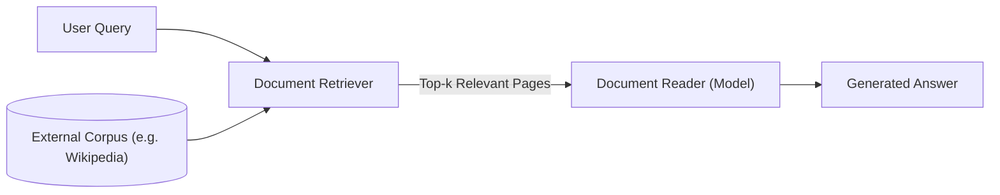
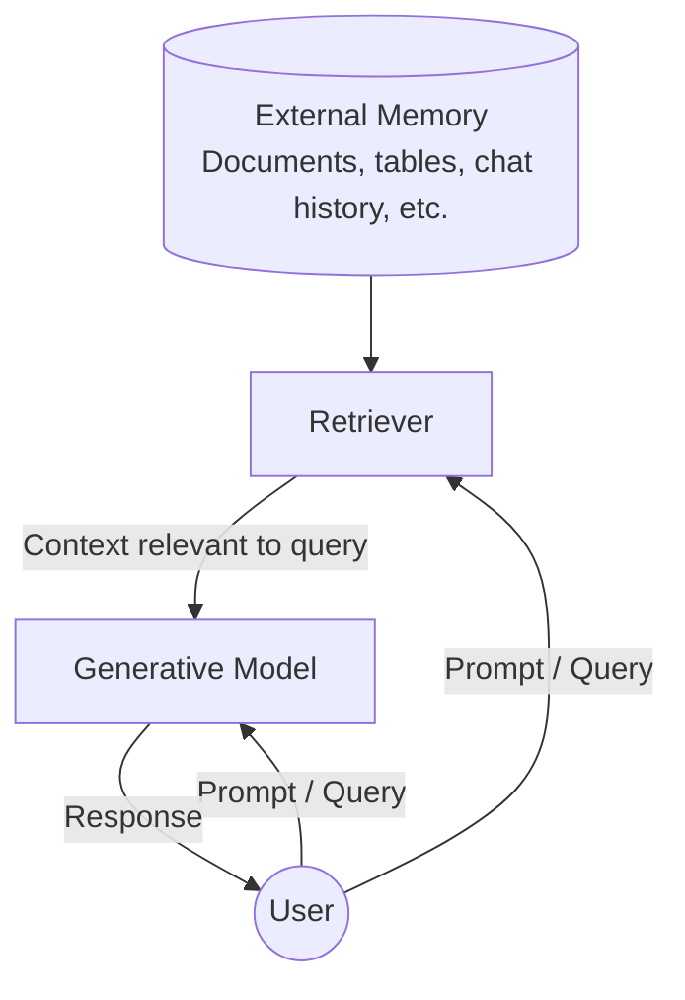
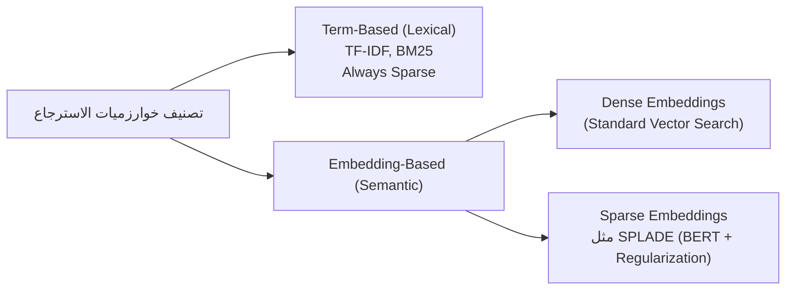
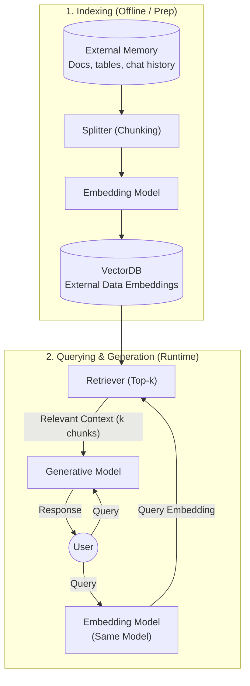
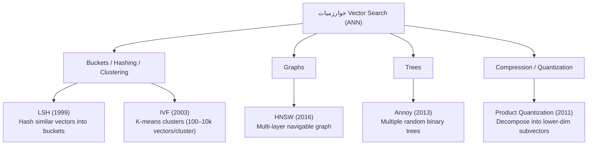
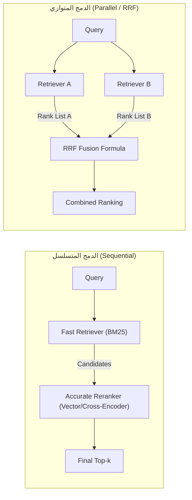
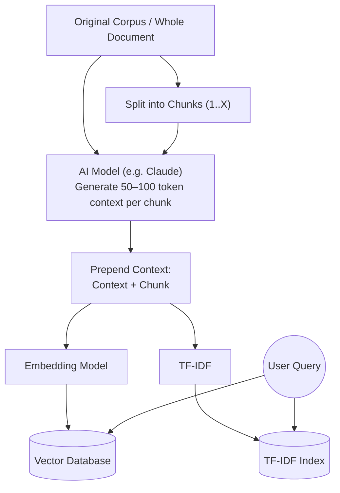

# الفصل 6 — الجزء 1: الـ RAG (`ص 253–275`)

> **ملاحظة:** هذه الملاحظات شرح تفصيلي صفحة بصفحة بأسلوب شخصي بالعامية المصرية مع الحفاظ على المصطلحات التقنية بالإنجليزية. أرقام الصفحات مطابقة لترقيم الكتاب المطبوع.

<BatchQuickNav
  :batches="[
    { label: 'الدفعة 1', anchor: '#batch-1', pages: '253–257' },
    { label: 'الدفعة 2', anchor: '#batch-2', pages: '258–261' },
    { label: 'الدفعة 3', anchor: '#batch-3', pages: '262–266' },
    { label: 'الدفعة 4', anchor: '#batch-4', pages: '267–272' }
  ]"
/>

---

## الدفعة 1: من مقدمة الفصل إلى مدخل خوارزميات الاسترجاع (`ص 253–257`) {#batch-1}

### صفحة 253 — مقدمة الفصل: ليه الموديل محتاج Context؟ وبداية الـ RAG

أي AI Model علشان يحل أي Task مطلوب منه، محتاج حاجتين أساسيتين:
1. **Instructions (التعليمات):** يعمل إيه وإزاي (وده اللي اتشرح في Chapter 5: Prompt Engineering).
2. **Necessary Information / Context (السياق والمعلومات اللازمة):** البيانات والحقائق اللي هيشتغل عليها.

زي الإنسان بالظبط: لو سألت حد سؤال ومعندوش المعلومات الكافية، غالباً هيغلط أو يفتي. نفس الكلام بيحصل مع الـ AI Models؛ لما ينقصها الـ **Context** بتغلط وبيزيد احتمال إنها تـ **Hallucinate**.

- **الفرق الجوهري بين Instructions و Context:**
  - الـ **Instructions** في أي تطبيق بتكون عامة ومشتركة لكل الـ Queries.
  - الـ **Context** بيكون مخصّص ومختلف لكل Query لوحده (`query-specific`).
  - هدف الفصل السادس هو: **إزاي تبني الـ Relevant Context المناسب لكل Query.**

#### النمطان المسيطران لبناء السياق (`Context Construction`)
1. **RAG (Retrieval-Augmented Generation):** نمط بيسمح للموديل يسترجع المعلومات المهمة من مصادر بيانات خارجية (`External Data Sources`).
2. **Agents (Agentic Pattern):** نمط بيسمح للموديل يستخدم أدوات خارجية (`Tools`) زي `Web Search` و`News APIs` علشان يجمع معلومات.

> **الفرق في الدور:** الـ **RAG** استخدامه الأساسي هو بناء الـ Context، إنما الـ **Agentic Pattern** بيعمل أكتر من كده بكتير: الـ Tools الخارجية بتعالج نقط ضعف الموديل، بتوسّع قدراته، والأهم إنها بتديه القدرة إنه **يتفاعل مباشرة مع العالم الحقيقي** (`Interact with the world`) ويؤتمت مهام كتير في حياتنا. الاتنين في وقت قصير قدروا يطلعوا Demos ومنتجات مبهرة خلت ناس كتير شايفة إنهم المستقبل.

#### تعريف الـ RAG
الـ **RAG** هو تقنية بتحسّن جودة الـ Generation عن طريق استرجاع المعلومات المناسبة من **External Memory Sources** (مصادر ذاكرة خارجية).
أمثلة لمصادر الذاكرة الخارجية:
- قاعدة بيانات داخلية للشركة (`Internal Database`).
- محادثات سابقة لنفس المستخدم (`Previous Chat Sessions`).
- الإنترنت.

---

### صفحة 254 — الجذور البحثية لـ RAG (أوراق 2017 و2020)

#### 1) نمط Retrieve-then-Generate (Chen et al., 2017)
أول ظهور موثق للنمط ده كان في ورقة بحثية بعنوان *"Reading Wikipedia to Answer Open-Domain Questions"* (سنة 2017):
- النظام بياخد سؤال المستخدم (مثال الورقة: *"How many of Warsaw's inhabitants spoke Polish in 1933?"*).
- الخطوة الأولى: **Document Retriever** بيجيب أكتر **5 صفحات Wikipedia** ليها علاقة بالسؤال.
- الخطوة الثانية: موديل قارئ سمّوه **Document Reader** يقرأ الصفحات دي ويطلع الإجابة (`833,500`).

> **معلومة هامشية (Footnote 1):** الموديل القارئ وقتها ما كانش Transformer! كان **LSTM (Long Short-Term Memory)**، وده نوع من الـ **Recurrent Neural Networks (RNNs)** اللي كانت مسيطرة على الـ **NLP** قبل ثورة الـ **Transformer** في 2018.

#### 2) تسمية مصطلح RAG (Lewis et al., 2020)
مصطلح **Retrieval-Augmented Generation (RAG)** اتصاغ لأول مرة في ورقة Facebook الشهيرة *"Retrieval-Augmented Generation for Knowledge-Intensive NLP Tasks"* (سنة 2020):
- الورقة قدمت الـ RAG كحل للمهام الكثيفة بالمعرفة (**Knowledge-Intensive Tasks**) اللي مستحيل تدخل فيها كل المعرفة المتاحة للموديل مرة واحدة.
- مع الـ RAG، الـ **Retriever** بيختار فقط المعلومات الأكثر ارتباطاً بالـ Query ويدخلها للموديل.
- النتيجة اللي وصلولها: وجود معلومات ذات صلة بيخلي الموديل يطلع إجابات **أكثر تفصيلاً** وفي نفس الوقت **بيقلل الـ Hallucinations**.

> **معلومة هامشية (Footnote 2):** في نفس التوقيت تقريباً (مايو 2020)، ورقة تانية من Facebook (**Petroni et al., 2020** — *"How Context Affects Language Models' Factual Predictions"*) أثبتت إن دمج نظام استرجاع (`Retrieval System`) مع **Pre-trained Language Model** بيرفع أداءه بشكل ضخم جداً في الأسئلة الحقائقية (**Factual Questions**).

---

### صفحة 255 — ليه الـ RAG مهمة؟ وهل الـ Long Context هيقضي عليها؟

#### مثال عملي وفائدة إدارة بيانات المستخدمين
- مثال (Chetan Tekur — Footnote 3): لو سألت الموديل *"Can Acme's fancy-printer-A300 print 100pps?"*، مستحيل يجاوب بدقة غير لو اديته مواصفات الطابعة دي في الـ Context.
- تقدر تفكر في الـ **RAG** كأداة لبناء **Context مخصّص لكل Query** بدل استخدام نفس الـ Context العام لكل الأسئلة.
- ده بيساعد جداً في **Managing User Data**: تقدر تدخل بيانات مستخدم معين في الـ Queries الخاصة بيه هو بس، وده يحفظ الخصوصية والصلاحيات.

::: tip تشبيه هندسي مهم
**Context Construction** للـ **Foundation Models** ≡ **Feature Engineering** للـ **Classical ML Models**.
الاتنين هدفهم واحد: تجهيز وإمداد الموديل بالمعلومات الضرورية علشان يعالج الـ Input صح.
:::

#### سؤال مهم: هل زيادة الـ Context Length هتموّت الـ RAG؟
في بدايات الـ Foundation Models، ظهر الـ RAG أساساً لتخطي محدودية طول السياق (`Context Limitations`). ناس كتير بتعتقد إن لو الـ Context Window بقت ضخمة كفاية، مش هنحتاج RAG. **المؤلفة بتعارض الرأي ده لسببين:**

1. **البيانات دايماً هتكون أكبر من أي Context Limit:**
   - مهما كبر طول الـ Context، دايماً فيه تطبيقات بياناتها أكبر بكتير.
   - حجم البيانات المتاحة في العالم بيكبر باستمرار؛ الناس بتنتج وتضيف بيانات جديدة ونادراً ما بتحذف بيانات قديمة. الـ Context Length بيتوسع بسرعة، لكن مش بسرعة كافية لملاحقة نمو البيانات.
   - **قانون باركنسون للـ Context (Footnote 4):** زي ما **Parkinson's Law** بيقول *"الشغل بيتمدد علشان يملى الوقت المتاح ليه"*، المؤلفة بتطرح نظرية مشابهة: **الـ Context بتاع أي تطبيق بيتمدد علشان يملى أقصى Context Limit يدعمه الموديل!**

2. **القدرة على استقبال Context طويل ≠ استخدامه بكفاءة:**
   - وجود Context Window كبيرة مش معناه إن الموديل هيستفيد منها صح (وده هيتناقش بتفصيل في `ص 218` — `Context Length and Context Efficiency`).
   - كل ما الـ Context يطول، يزيد احتمال إن الموديل يتشتت ويركز على الجزء الغلط.
   - بالإضافة إن كل Token زيادة في الـ Input معناه **Cost أعلى** واحتمال **Latency أعلى**.
   - الـ RAG بيسمحلك تبعت **أهم المعلومات فقط** لكل Query ← **Input Tokens أقل + Performance أفضل**.

> **نظرة مستقبلية:** تطوير طول الـ Context ماشي بالتوازي مع تطوير كفاءة استغلال السياق، والمؤلفة تتوقع إن شركات النماذج (`Model Providers`) في المستقبل ممكن تدمج آلية شبيهة بالـ Retrieval أو الـ Attention جوه الموديل نفسه علشان يلتقط أهم أجزاء السياق تلقائياً.

---

### صفحة 256 — قاعدة Anthropic للـ 200k Tokens + معمارية الـ RAG (`RAG Architecture`)

::: info إرشاد عملي من Anthropic (2024)
شركة **Anthropic** اقترحت بخصوص نماذج **Claude** إن لو الـ **Knowledge Base** بتاعتك حجمها أصغر من **200,000 tokens** (يعني حوالي **500 صفحة**)، تقدر تحطها كلها مباشرة في الـ Prompt ومش هتحتاج RAG ولا طرق مشابهة. والمؤلفة بتتمنى إن باقي مطوري النماذج يقدموا إرشادات عملية واضحة زي دي لتحديد إمتى نستخدم RAG وإمتى يكفي Long Context.
:::

#### معمارية الـ RAG الأساسية (`RAG Architecture`)
أي نظام RAG بيتكون من عنصرين أساسيين:
1. **Retriever:** بيجيب المعلومات المناسبة من مصادر الذاكرة الخارجية (`External Memory`).
2. **Generator (Generative Model):** بيولّد الإجابة النهائية بناءً على السؤال والمعلومات المسترجعة.

#### طريقة التدريب: منفصلين ولا مع بعض؟
- في ورقة **Lewis et al. (2020)** الأصلية، دربوا الـ Retriever والـ Generative Model **مع بعض** (`Trained Together`).
- في الأنظمة الحالية في الواقع العملي، المكونين غالباً بيتدربوا بشكل منفصل، وفرق كتير بتستخدم Retrievers وModels جاهزة (**Off-the-shelf**).
- مع ذلك، عمل **End-to-End Finetuning** لنظام الـ RAG بالكامل مع بعض يقدر يرفع الأداء بشكل كبير.

#### وظيفتا الـ Retriever
نجاح نظام الـ RAG كله بيعتمد على جودة الـ **Retriever**، واللي بيقوم بوظيفتين أساسيتين:
1. **Indexing (الفهرسة):** معالجة وتنظيم البيانات وتخزينها بشكل يسهّل ويسرّع استرجاعها لاحقاً. *(مهم جداً: طريقة الـ Indexing بتتحدد بناءً على الطريقة اللي ناوي تسترجع بيها البيانات بعدين).*
2. **Querying (الاستعلام):** إرسال الـ Query وقت التشغيل علشان تسترجع البيانات المرتبطة بيه.

**سيناريو تمثيلي:** تخيل إن الـ External Memory هي قاعدة بيانات مستندات شركة فيها مذكرات (`Memos`)، عقود (`Contracts`)، ومحاضر اجتماعات (`Meeting Notes`)...

---

### صفحة 257 — الحاجة للـ Chunking + مدخل خوارزميات الاسترجاع (`Retrieval Algorithms`)

#### ليه بنقسّم المستندات (`Chunking`)؟
المستند الواحد في قاعدة البيانات ممكن يكون **10 tokens** أو **1 مليون token**. لو استرجعت المستندات كاملة بدون تقسيم (`Naively`)، الـ Context هيتضخم بشكل غير محدود.
الحل: نقسّم كل مستند لأجزاء أصغر قابلة للإدارة اسمها **Chunks** (استراتيجيات الـ Chunking هتيجي بالتفصيل لاحقاً في هذا الفصل).
بعد استرجاع أهم الـ Chunks للـ Query، غالباً بنحتاج خطوة **Minor Post-processing** علشان ندمج الـ Chunks المسترجعة مع الـ User Prompt ونكوّن الـ **Final Prompt** اللي بيدخل للـ **Generative Model**.

> **تنبيه مصطلحات مهم (Terminology Note):**
> في هذا الفصل، المؤلفة بتستخدم كلمة **"Document"** لتشير لـ "المستند الكامل" أو الـ "Chunk" على حد سواء؛ لأن تقنياً أي Chunk مقتطع من مستند هو نفسه يُعتبر Document في مصطلحات **Classical NLP** وعلم **Information Retrieval (IR)**.

#### مدخل إلى `Retrieval Algorithms`
الاسترجاع مش فكرة جديدة خاصة بالـ RAG؛ علم **Information Retrieval (IR)** عمره حوالي قرن كامل!
- **معلومة تاريخية (Footnote 5):** بدايات استرجاع المعلومات اتوصفت من عشرينيات القرن الماضي (1920s) في براءات اختراع **Emanuel Goldberg** لآلة سماها **"Statistical Machine"** كانت بتبحث في مستندات متخزنة على أفلام (المرجع: Sanderson and Croft, *Proceedings of the IEEE*, 2012).
- الـ IR هو الأساس اللي قامت عليه:
  - محركات البحث (**Search Engines**).
  - أنظمة التوصية (**Recommender Systems**).
  - تحليل السجلات (**Log Analytics**).
- كتير من الخوارزميات الناضجة اللي اتطورت للأنظمة التقليدية دي تنفع وتتطبق مباشرة في الـ RAG. ولأن الـ IR مجال بحثي وصناعي ضخم صعب يتغطى في صفحات قليلة، الفصل بيعرض الخطوط العريضة وبيرشح مصادر إضافية أعمق في مستودع الكتاب على GitHub.

> **الفرق بين `Retrieval` و `Search`:**
> تقليدياً، **Retrieval** بيحصل جوه قاعدة بيانات أو نظام واحد، بينما **Search** بيشمل الاسترجاع عبر أنظمة وقواعد بيانات متعددة. لكن في الفصل ده بتستخدم المؤلفة المصطلحين بالتبادل (`Interchangeably`).

#### جوهر أي خوارزمية استرجاع
في الأساس، أي Retrieval بيشتغل عن طريق **ترتيب المستندات (`Ranking Documents`)** بناءً على درجة صلتها (`Relevance`) بالـ Query المطلوب. الخوارزميات بتختلف في طريقة حساب الـ **Relevance Scores**.
وهنا الفصل بيبدأ بالنوعين الأشهر:
1. **Term-Based Retrieval** (الاسترجاع المبني على الكلمات/المصطلحات) — يبدأ شرحه في صفحة 258.
2. **Embedding-Based Retrieval** (الاسترجاع المبني على المتجهات الدلالية) — يبدأ شرحه بعدها.

<QuickFlashcards
  title="مراجعة سريعة — الدفعة 1 (ص 253–257)"
  :cards="[
    {
      q: 'إيه الفرق الجوهري بين Instructions و Context في أي تطبيق AI؟',
      a: 'الـ Instructions بتكون عامة ومشتركة لكل الـ Queries، بينما الـ Context مخصص ومختلف لكل Query لوحده (query-specific)، وبناء الـ Context للـ Foundation Models يعادل Feature Engineering في الـ Classical ML.'
    },
    {
      q: 'ليه المؤلفة شايفة إن زيادة الـ Context Length مش هتقضي على الـ RAG؟',
      a: 'لسببين: (1) البيانات دايماً بتكبر أسرع من أي Context Window (قانون باركنسون للـ Context)، (2) طول السياق بيخلي الموديل يتشتت أحياناً، وكل Token زيادة بيزود الـ Cost والـ Latency.'
    },
    {
      q: 'إيه هي وظيفتا الـ Retriever الأساسية في معمارية الـ RAG؟',
      a: '(1) Indexing: تجهيز وتنظيم البيانات لسرعة الاسترجاع لاحقاً، (2) Querying: إرسال الـ Query وقت التشغيل لاسترجاع البيانات المرتبطة بيه.'
    },
    {
      q: 'إمتى Anthropic اقترحت الاستغناء عن الـ RAG في نماذج Claude؟',
      a: 'لو الـ Knowledge Base أصغر من 200,000 tokens (حوالي 500 صفحة) — وقتها تقدر تحطها كلها مباشرة في الـ Prompt.'
    }
  ]"
/>

<BatchCheck id="ch06-b1" label="الدفعة 1 (ص 253–257): مقدمة الفصل وRAG Architecture" />

---

## الدفعة 2: خوارزميات الاسترجاع — Term-Based مقابل Embedding-Based (`ص 258–261`) {#batch-2}

### صفحة 258 — تصنيف Sparse vs Dense ولماذا اختار الكتاب تصنيفاً أدق؟ + بداية Term-Based Retrieval

#### 1) صندوق مهم: `Sparse Versus Dense Retrieval`
في الأبحاث والمقالات، غالباً هتشوف خوارزميات الاسترجاع بتتقسم إلى: **Sparse** مقابل **Dense**. لكن الكاتبة في الكتاب ده فضّلت تقسيم مختلف وأدق: **`Term-based` مقابل `Embedding-based`**. ليه؟

- **Sparse Retrievers (المتجهات المتناثرة):**
  - بتمثّل البيانات بـ **Sparse Vectors** — يعني متجه أغلب قيمه أصفار (`0`).
  - الـ **Term-Based Retrieval** بيُعتبر Sparse لأن كل كلمة ممكن تتمثل بـ **Sparse One-Hot Vector**: متجه كله أصفار ما عدا خانة واحدة فيها `1`، وطول المتجه يساوي عدد كلمات القاموس (`Vocabulary`)، ومكان الـ `1` هو ترتيب الكلمة في القاموس.
  - **مثال:** لو القاموس فيه 3 كلمات بس `{"food": 0, "banana": 1, "slug": 2}`، هتكون متجهات الـ One-Hot هي:
    - `"food"` ← `[1, 0, 0]`
    - `"banana"` ← `[0, 1, 0]`
    - `"slug"` ← `[0, 0, 1]`

- **Dense Retrievers (المتجهات الكثيفة):**
  - بتمثّل البيانات بـ **Dense Vectors** — يعني متجه أغلب قيمه مش أصفار (`non-zero`).
  - الـ **Embedding-Based Retrieval** غالباً بيُعتبر Dense لأن الـ Embeddings في العادة Dense Vectors.
  - **لكن فيه استثناء مهم جداً: Sparse Embeddings!**
    - مثال عليه خوارزمية **SPLADE (Sparse Lexical and Expansion)** (Formal et al., 2021): دي بتستخدم Embeddings متولدة من موديل **BERT**، لكنها بتستخدم **Regularization** يزق معظم قيم المتجه ناحية الصفر علشان العمليات الحسابية تكون أسرع وأكفأ.
  - **ليه تصنيف `Sparse vs Dense` بيعمل لخبطة؟**
    - لو قسمت الدنيا `Sparse vs Dense`، هتلاقي **SPLADE** اتحط بالغلط في نفس خانة الـ Term-based، مع إن طريقة شغله ونقط قوته وضعفه شبه الـ **Dense Embedding Retrieval** بكتير! لذلك تقسيم **`Term-based vs Embedding-based`** بيمنع الخلط ده.

#### 2) بداية `Term-Based Retrieval` (الاسترجاع المبني على الكلمات / `Lexical Retrieval`)
أبسط طريقة علشان تلاقي مستندات مناسبة لـ Query هي إنك تدور على الكلمات المفتاحية (**Keywords**). مثلاً لو الـ Query هو `"AI engineering"`، النظام هيجيب كل المستندات اللي فيها عبارة `"AI engineering"`.
بس الطريقة البسيطة دي فيها **مشكلتين أساسيتين**:
1. **مشكلة العدد وحدود الـ Context:** ممكن مستندات كتير جداً تحتوي الكلمة، والـ Context Window متكفيش تحطهم كلهم.
   - الحل التقديري (**Heuristic**): اختار المستندات اللي الكلمة اتكررت فيها أكتر عدد من المرات، على افتراض إن تكرار الكلمة يعني صلة أقوى. عدد مرات ظهور الكلمة في المستند اسمه **Term Frequency (TF)**.
2. **مش كل الكلمات ليها نفس الأهمية:** الـ Prompt ممكن يكون طويل وفيه كلمات مهمة وكلمات حشو.
   - **مثال الكتاب:** الـ Query `"Easy-to-follow recipes for Vietnamese food to cook at home"` فيه 9 كلمات (`easy-to-follow`, `recipes`, `for`, `vietnamese`, `food`, `to`, `cook`, `at`, `home`). الطبيعي إنك عايز تركز على كلمات غنية بالمعنى زي `vietnamese` و`recipes` مش كلمات زي `for` و`at`! إذن محتاجين طريقة تميز الكلمات المهمة.

---

### صفحة 259 — مقياس `IDF`، معادلة `TF-IDF`، الـ `Inverted Index`، وبداية `BM25`

#### 1) فكرة `IDF (Inverse Document Frequency)`
البديهة بتقول: كل ما الكلمة تظهر في مستندات أكتر، كل ما قيمتها التمييزية تقل (**Less Informative**). كلمات زي `"for"` و`"at"` غالباً موجودة في معظم المستندات، فملهاش وزن تمييزي.
إذن أهمية الكلمة تتناسب **عكسياً** مع عدد المستندات اللي ظهرت فيها، وده مقياس **IDF**:
- تعدّ المستندات اللي فيها الكلمة، وتقسم إجمالي عدد المستندات على العدد ده.
- **مثال:** لو عندنا `10` مستندات، وفيه `5` منهم فيهم الكلمة، تبقى النسبة `10 / 5 = 2`. كل ما الـ IDF يكبر، الكلمة تكون أندر وأهم.

#### 2) خوارزمية `TF-IDF` ومعادلتها الرياضية
خوارزمية **TF-IDF** بتدمج المقياسين مع بعض (`TF × IDF`). لو عندنا Query فيه الكلمات $t_1, t_2, \dots, t_q$ ومستند $D$:
- تكرار الكلمة $t$ في المستند $D$ نرمز له بـ `f(t, D)`.
- إجمالي عدد المستندات `N`، وعدد المستندات التي تحتوي الكلمة `t` هو `C(t)`.
- قيمة الـ IDF تُحسب باللوغاريتم:
  $$\text{IDF}(t) = \log \frac{N}{C(t)}$$
- وتقدير صلة المستند $D$ بالـ Query $Q$ (بشكل مبسط) هو مجموع حاصل ضرب الـ IDF في الـ TF لكل كلمات الـ Query:
  $$\text{Score}(D, Q) = \sum_{i=1}^{q} \text{IDF}(t_i) \times f(t_i, D)$$

#### 3) الحلول الشائعة والـ `Inverted Index` (مثل `Table 6-1`)
من أشهر أدوات الـ Term-based Retrieval: **Elasticsearch** و**BM25**.
- **Elasticsearch** (Shay Banon, 2010) مبني فوق **Lucene**، وبيستخدم هيكل بيانات اسمه **Inverted Index (الفهرس المعكوس)**.
- الفكرة: بدل ما تدخل جوه كل مستند تدور على الكلمات، بتعمل قاموس (`Dictionary`) يربط كل كلمة (`Term`) بقائمة المستندات اللي بتحتويها، ومعاها بيانات إضافية زي `Document Count` و`Term Frequency` علشان حساب `TF-IDF` يتم في لحظة.

**جدول توضيحي لفكرة الـ Inverted Index (مكافئ لـ Table 6-1):**

| الكلمة (`Term`) | عدد المستندات (`Document count`) | قائمة `(رقم المستند, التكرار TF)` |
| :--- | :--- | :--- |
| `banana` | `2` | `(10, 3), (5, 2)` |
| `machine` | `4` | `(1, 5), (10, 1), (38, 9), (42, 5)` |
| `learning` | `3` | `(1, 5), (38, 7), (42, 5)` |

#### 4) بداية `Okapi BM25`
**Okapi BM25** (الجيل الـ 25 من خوارزمية *Best Matching*، طورها Robertson وآخرون في التمانينات) هي تطوير مباشر لـ `TF-IDF`.
الفرق الجوهري الأول: مقارنة بـ `TF-IDF` الساذجة، **BM25** بتعمل **Normalize** لقيم تكرار الكلمات (`Term Frequency`) بناءً على **طول المستند (`Document Length`)**...

---

### صفحة 260 — تكملة `BM25`، الـ `Tokenization`، والانتقال إلى `Embedding-Based Retrieval`

#### 1) لماذا التطبيع بطول المستند في `BM25`؟ ومكانتها في الصناعة
المستندات الأطول طبيعي احتمال وجود الكلمة فيها وتكرارها يكون أعلى من المستندات القصيرة، مش لأنها أدق، لكن لمجرد إنها أطول؛ وده اللي بتعالجه **BM25** بذكاء.
- **معلومة هامشية (Footnote 6):** للّي حابب يتعمق في رياضيات BM25، الكاتبة بترشح ورقة مؤلفيها: *"The Probabilistic Relevance Framework: BM25 and Beyond"* (Robertson and Zaragoza, 2009).
- نسخ BM25 المطورة زي **`BM25+`** و**`BM25F`** لسه مستخدمة على نطاق واسع في الإنتاج، وبتعتبر **Baseline** قوي جداً لما تقارن بيه أي خوارزمية أحدث زي الـ Embedding-based Retrieval.
- **معلومة هامشية (Footnote 7):** حتى **Aravind Srinivas** (الرئيس التنفيذي لـ Perplexity) غرّد قبل كده وقال: *"تحقيق تحسن حقيقي يتفوق على BM25 أو الـ full-text search أمر صعب."*

#### 2) عملية الـ `Tokenization` والتنظيف (`Preprocessing`)
عملية تقطيع الـ Query لكلمات/مصطلحات منفصلة اسمها **Tokenization**.
- **فخ التقطيع كلمة بكلمة:** لو قطعت كل كلمة لوحدها، المصطلحات المركبة بتتكسر وتفقد معناها؛ مثلاً `"hot dog"` لو اتقطعت لـ `"hot"` و`"dog"` كل كلمة لوحدها مبقتش تعبر عن الأكلة!
- **الحل:** التعامل مع الـ **n-grams** الشائعة كـ Term واحد (مثلاً لو الـ Bigram `"hot dog"` شائع، يتفهرس كوحدة واحدة).
- خطوات إضافية شائعة (غالباً أدوات الـ Term-based بتعملها أوتوماتيك):
  1. تحويل الحروف لـ `Lowercase`.
  2. حذف علامات الترقيم (`Punctuation`).
  3. حذف الكلمات الشائعة غير المؤثرة (**Stop Words**) زي `"the"`, `"and"`, `"is"`.
  - مكتبات NLP الكلاسيكية زي **NLTK** و**spaCy** و**Stanford CoreNLP** بتوفر أدوات جاهزة للـ Tokenization ده.

#### 3) سؤال: هل ينفع الاسترجاع بـ `n-gram overlap`؟ (ربط مع Ch. 4)
Chapter 4 بيناقش قياس التشابه اللفظي بين نصين عن طريق تداخل الـ `n-grams`. ينفع نستخدمه في الاسترجاع، **لكن بشرط:**
- يشتغل كويس لما يكون **طول الـ Query قريب من طول المستند**.
- لو المستندات أطول بكتير من الـ Query، احتمال إنها تحتوي n-grams من الـ Query هيرتفع جداً، فتلاقي مستندات كتير واخدة Scores عالية متقاربة، وتفقد القدرة على التمييز بين المستند المهم فعلاً والمستند الأقل صلة!

#### 4) بداية `Embedding-Based Retrieval` (`Semantic Retrieval`)
مشكلة الـ Term-based Retrieval الجوهرية إنه بيحسب الصلة على **المستوى اللفظي (`Lexical Level`)** مش على **مستوى المعنى (`Semantic Level`)** (وزي ما اتشرح في Ch. 3، شكل النص لوحده ما بيعكسش دايماً معناه).
- **مثال صارخ:** لو بحثت عن `"transformer architecture"` في نظام لفظي، ممكن يرجعلك مقالات عن المحولات الكهربائية (`Electric Device`) أو سلسلة أفلام *Transformers*!
- على العكس، الـ **Embedding-Based Retrievers** (أو **Semantic Retrieval**) بترتب المستندات حسب **مدى تقارب المعنى** مع الـ Query.

---

### صفحة 261 — كيف يشتغل الـ `Embedding-Based Retriever` عملياً؟ (`Figure 6-3`)

في الـ **Embedding-Based Retrieval**، مرحلة الفهرسة (**Indexing**) بتاخد وظيفة إضافية: بعد تقسيم المستندات لـ Chunks (`Splitter`)، بنحوّل كل Chunk لـ **Embedding** ونخزن المتجهات الناتجة في **Vector Database (`VectorDB`)**.

أما وقت التشغيل (**Querying**)، فالعملية بتمشي في خطوتين أساسيتين للـ Retrieval، وبعدهم خطوة التوليد (كما في مخطط `Figure 6-3` بالكتاب):
1. **Embedding Model:** تحويل الـ Query بتاع المستخدم إلى Embedding **باستخدام نفس الـ Embedding Model** اللي استخدمناه وقت الـ Indexing (نقطة حاسمة علشان المتجهات تكون في نفس الفضاء الدلالي).
2. **Retriever:** يسحب أقرب **`k` data chunks** متجهاتها قريبة من الـ Query Embedding في الـ VectorDB. *(عدد الـ `k` اللي هتسحبه بيعتمد على طبيعة التطبيق، الـ Generative Model، والـ Query نفسه).*
3. **Generative Model:** يستقبل الـ Query مع الـ `k` chunks المسترجعة كـ Context ويولّد الإجابة النهائية.

> **ملاحظة إنتاجية ومقارنة بالـ Recommender Systems (Footnote 8):**
> التدفق اللي فوق ده مبسط؛ في أنظمة الإنتاج الحقيقية، الـ Semantic Retrieval غالباً بيزود مكونات تانية زي **Reranker** لإعادة ترتيب النتائج المرشحة بدقة أعلى، و**Caches** لتقليل الـ **Latency**. والكاتبة بتلفت الانتباه في الهامش إن خطوات الاسترجاع في الـ RAG شبه جداً خطوات أنظمة التوصية التقليدية (**Traditional Recommender Systems**).

#### تذكير حاسم عن الـ Embeddings (من Ch. 3)
الـ **Embedding** هو متجه رقمي بيهدف للحفاظ على الخصائص والمعاني المهمة للبيانات الأصلية. والقاعدة الذهبية هنا: **لو الـ Embedding Model ضعيف أو مش مناسب لمجالك، الـ Embedding-Based Retriever كله مش هيشتغل كويس** مهما حسّنت باقي المكونات.

<QuickFlashcards
  title="مراجعة سريعة — الدفعة 2 (ص 258–261)"
  :cards="[
    {
      q: 'ليه الكتاب اختار تصنيف Term-based vs Embedding-based بدل Sparse vs Dense؟',
      a: 'لأن فيه طرق زي SPLADE بتستخدم Sparse Embeddings (من BERT مع Regularization)، فالتصنيف القديم بيحطها بالغلط مع الـ Term-based رغم إن سلوكها وقوتها شبه الـ Embedding-based.'
    },
    {
      q: 'إيه الفرق الأساسي بين BM25 و TF-IDF الساذجة؟',
      a: 'BM25 بتعمل Normalize لقيم تكرار الكلمات (TF) بناءً على طول المستند، علشان المستندات الطويلة ما تاخدش Score أعلى لمجرد طولها.'
    },
    {
      q: 'إيه مشكلة تقطيع النص كلمة بكلمة في الـ Tokenization وإزاي بنعالجها؟',
      a: 'المصطلحات المركبة زي hot dog بتتفكك لكلمات تفقد معناها الأصلي؛ والحل هو معاملة الـ n-grams الشائعة كـ Term واحد مع إزالة Stop words وعلامات الترقيم وتوحيد حالة الحروف.'
    },
    {
      q: 'إيه الشرط الأساسي وقت تحويل الـ Query لـ Embedding في الـ Semantic Retrieval؟',
      a: 'لازم تستخدم نفس الـ Embedding Model اللي اتعمل بيه الـ Indexing علشان الـ Query والـ Chunks يكونوا في نفس الـ Vector Space.'
    }
  ]"
/>

<BatchCheck id="ch06-b2" label="الدفعة 2 (ص 258–261): Term-Based (TF-IDF, BM25) vs Embedding Retrieval" />

---

## الدفعة 3: Vector Databases وخوارزميات البحث التقريبي ومقارنة الخوارزميات (`ص 262–266`) {#batch-3}

### صفحة 262 — قواعد بيانات المتجهات (`Vector Databases`) ومسألة البحث (`k-NN` مقابل `ANN`)

الـ `Embedding-Based Retrieval` بيضيف مكون جديد في المعمارية: **Vector Databases**.
- تخزين المتجهات (`Storing Vectors`) هو الجزء السهل في الـ Vector Database؛ **الجزء الصعب الحقيقي هو Vector Search**: لما ييجي `Query Embedding`، لازم قاعدة البيانات تلاقي وترجّع أقرب المتجهات ليه بسرعة وكفاءة، وده بيعتمد على طريقة فهرسة وتخزين المتجهات.
- زي آليات كتير في الـ GenAI، الـ **Vector Search** مش اختراع خاص بالـ LLMs؛ ده موجود من زمان في أي تطبيق بيستخدم Embeddings زي: محركات البحث، أنظمة التوصية، تنظيم البيانات، الـ `Clustering`، وكشف الاحتيال (`Fraud Detection`).

#### 1) المشكلة: `Nearest-Neighbor Search` والحل الساذج `k-NN`
عادةً مشكلة البحث في المتجهات بتتصاغ كالتالي: *بإعطاء Query، هات أقرب `k` متجهات ليه.*
الحل المباشر الساذج هو **k-NN (k-Nearest Neighbors)** وبيمشي في 3 خطوات:
1. احسب درجة التشابه (`Similarity Score` زي **Cosine Similarity**) بين الـ `Query Embedding` و**كل المتجهات** الموجودة في قاعدة البيانات.
2. رتب كل المتجهات حسب درجة التشابه.
3. رجّع أعلى `k` متجهات.

- **عيبه:** رغم إنه بيضمن دقة كاملة (`Precise`)، إلا إنه **مكلف جداً حسابياً وبطيء**، وبالتالي يصلح فقط للـ Datasets الصغيرة.

#### 2) الحل العملي للبيانات الضخمة: `ANN (Approximate Nearest Neighbor)`
لما البيانات تكبر، بنستبدل `k-NN` بخوارزميات **ANN (البحث التقريبي عن الجار الأقرب)**.
- **أشهر المكتبات مفتوحة المصدر:**
  - **FAISS** (Facebook AI Similarity Search — Johnson et al., 2017)
  - **ScaNN** (Google Scalable Nearest Neighbors — Sun et al., 2020)
  - **Annoy** (Spotify — Bernhardsson, 2013)
  - **Hnswlib** (Hierarchical Navigable Small World — Malkov and Yashunin, 2016)
- أغلب مطوري التطبيقات مش هيكتبوا خوارزميات Vector Search من الصفر، لكن فهم فكرتها مهم لتقييم الحلول واختيار الأداة المناسبة.

#### 3) الفكرة الهندسية لتنظيم المتجهات
بشكل عام، قواعد بيانات المتجهات بتنظم الـ Vectors في واحدة من 3 هياكل: **Buckets** أو **Trees** أو **Graphs**. الخوارزميات بتختلف في الـ `Heuristics` اللي بتستخدمها علشان تضمن إن المتجهات المتشابهة تبقى قريبة من بعض. كمان ممكن نعمل للمتجهات **Quantization** (تقليل الدقة الرقمية) أو نخليها **Sparse** علشان نقلل الحمل الحسابي. *(الكاتبة بتحيل لسلسلة Zilliz التعليمية للاستزادة).*

---

### صفحة 263 — أشهر 5 خوارزميات Vector Search + ملاحظة عن قواعد البيانات التقليدية

1. **LSH (Locality-Sensitive Hashing)** *(Indyk and Motwani, 1999)*:
   - خوارزمية قوية ومتعددة الاستخدامات (تشتغل حتى مع حاجات غير المتجهات).
   - بتعمل Hash للمتجهات المتشابهة علشان تقع في نفس الـ **Buckets**؛ بتسرّع البحث جداً مقابل التضحية بجزء بسيط من الدقة. موجودة في **FAISS** و**Annoy**.
2. **HNSW (Hierarchical Navigable Small World)** *(Malkov and Yashunin, 2016)*:
   - بتبني **Multi-layer Graph**: العقد (`Nodes`) هي المتجهات، والحواف (`Edges`) بتربط المتجهات المتشابهة ببعض.
   - البحث بيتم عن طريق التجول على حواف الرسم البياني (`Traversing Graph Edges`). ليها تنفيذ مفتوح المصدر من المؤلفين وموجودة في **FAISS** و**Milvus**.
3. **Product Quantization (PQ)** *(Jégou et al., 2011)*:
   - بتقلص حجم كل متجه بتمثيل أبسط وأقل أبعاداً عن طريق تكسير المتجه لعدة **Subvectors**.
   - حساب المسافات على الأبعاد المختزلة أسرع بكتير. جزء أساسي في **FAISS** ومدعومة في أغلب المكتبات.
4. **IVF (Inverted File Index)** *(Sivic and Zisserman, 2003)*:
   - بتستخدم **K-means Clustering** لتجميع المتجهات المتشابهة في نفس الـ Cluster (عادةً يُضبط عدد الـ Clusters بحيث يكون في المتوسط `100` إلى `10,000` متجه في كل Cluster).
   - وقت الـ Query: تحدد أقرب مراكز المجموعات (**Cluster Centroids**) وتعتبر المتجهات اللي جواها هي المرشحين الجيران فقط. مع **Product Quantization** بيشكلوا العمود الفقري لـ **FAISS**.
5. **Annoy (Approximate Nearest Neighbors Oh Yeah)** *(Bernhardsson, 2013)*:
   - طريقة مبنية على الأشجار (**Tree-based**): تبني عدة أشجار ثنائية (**Binary Trees**)، كل شجرة تقسم المتجهات بمعايير عشوائية (زي رسم خط عشوائي يفصل البيانات لفرعين). وقت البحث تتتبع الأشجار دي لتجميع المرشحين. (فتحتها **Spotify** كمصدر مفتوح).

- **خوارزميات إضافية مذكورة:** **Microsoft's SPTAG** (Space Partition Tree And Graph) و**FLANN** (Fast Library for Approximate Nearest Neighbors).

> **تنبيه مهم في نهاية الصفحة:** رغم ظهور تصنيف "Vector Databases" كفئة مستقلة مع صعود الـ RAG، تقنياً **أي قاعدة بيانات تقدر تخزن المتجهات هي Vector Database**. وكثير من قواعد البيانات التقليدية أضافت (أو في طريقها لإضافة) دعم تخزين والبحث عن المتجهات.

---

### صفحة 264 — مقارنة خوارزميات الاسترجاع (`Comparing Retrieval Algorithms`) ومقاييس الجودة

#### 1) مقارنة الأداء وسهولة التعديل والـ Edge Cases
الاثنين (`Term-based` و`Embedding-based`) ليهم حلول ناضجة وسهل تبدأ بيهم، لكن لكل واحد مميزاته وعيوبه:
- **Term-Based Retrieval:**
  - **أسرع بكتير** في الـ Indexing والـ Querying (استخراج الكلمات أسرع من توليد Embeddings، والربط عبر Inverted Index أرخص حسابياً من Nearest-Neighbor Search).
  - بيشتغل كويس جداً **Out of the box** (`Elasticsearch`, `BM25`)، لكن بساطته معناها مكونات أقل تقدر تعدّلها أو تدربها علشان ترفع الأداء أكتر.
- **Embedding-Based Retrieval:**
  - تقدر تحسّنه بشكل كبير مع الوقت ليتفوق على Term-based (بأنك تعمل **Finetune** للـ Embedding Model أو الـ Retriever لوحده، أو مع بعض، أو End-to-End مع الـ Generative Model).
  - **نقطة ضعف خطيرة:** تحويل النص لـ Embeddings ممكن **يطمس الكلمات الدقيقة (`Obscure Keywords`)**، زي أكواد الأخطاء المحددة مثل `EADDRNOTAVAIL (99)` أو أسماء المنتجات الدقيقة، فيصعب العثور عليها! *(وده بيتحل بدمج الطريقتين معاً)*.

#### 2) مقاييس تقييم الـ Retriever في الـ RAG
أشهر مقياسين لتقييم جودة البيانات المسترجعة هما:
- **Context Precision (أو Context Relevance):** من إجمالي المستندات اللي النظام رجعها، كم في المية منها فعلاً مرتبط بالـ Query؟
- **Context Recall:** من إجمالي المستندات المرتبطة بالـ Query في قاعدة البيانات كلها، كم في المية النظام قدر يرجعها؟

- **إزاي بيتحسبوا؟** بتجهز **Evaluation Set** فيها أسئلة اختبار (`Test Queries`) ومستندات، ويتم تصنيف كل مستند لكل سؤال (مرتبط أم لا) بواسطة بشر أو `AI Judges`.
- **ملاحظة إنتاجية حاسمة:** في الإنتاج (`Production`)، بعض أطر تقييم الـ RAG بتدعم **Context Precision فقط** ومش **Context Recall**! ليه؟ لأن حساب `Context Recall` محتاج تصنف مدى صلة **كل مستندات الداتابيز** بكل Query، وده شبه مستحيل في القواعد الكبيرة؛ بينما `Context Precision` أسهل بكتير لأنه محتاج بس تقارن المستندات القليلة اللي رجعت بالسؤال (وممكن `AI Judge` يعمله بسهولة).

---

### صفحة 265 — مقاييس الترتيب (`Ranking Metrics`)، تقييم الـ Embeddings، التكلفة والـ Latency

#### 1) مقاييس الترتيب (`Ranking`) وتقييم الـ Embeddings
- لو يهمك مش بس إن المستندات الصح ترجع، لكن **ترتيبها** كمان (المستند الأدق يطلع في الأول)، تستخدم مقاييس زي:
  - **NDCG** (*Normalized Discounted Cumulative Gain*)
  - **MAP** (*Mean Average Precision*)
  - **MRR** (*Mean Reciprocal Rank*)
- بالنسبة للـ **Semantic Retrieval**، لازم تقيم جودة الـ **Embeddings** نفسها (كمان اتناقش في Ch. 3): سواء بشكل مستقل (المستندات المتشابهة متجهاتها أقرب) أو عبر مهام محددة مثل **MTEB Benchmark** (Muennighoff et al., 2023) اللي بيختبر الـ Embeddings في الاسترجاع والتصنيف والـ Clustering.
- **المقياس الأهم في الآخر:** تقييم الـ Retriever جوه **نظام الـ RAG كله** — الـ Retriever الكويس هو اللي يساعد النظام يولّد إجابات عالية الجودة.

#### 2) مقايضة التكلفة والـ `Latency`
- **الـ Latency:** صحيح إن معظم زمن استجابة الـ RAG جاي من توليد المخرجات (`Output Generation`) خصوصاً لما الإجابة تكون طويلة، فالتأخير الإضافي من توليد Query Embedding والبحث في الـ VectorDB ممكن يبان قليل مقارنة بالإجمالي؛ **ومع ذلك** يقدر يأثر على تجربة المستخدم (`UX`).
- **التكلفة (`Cost`):**
  - توليد الـ Embeddings بيكلف فلوس، ودي مشكلة ضخمة لو بياناتك بتتغير باستمرار وتضطر تعيد توليدها (تخيل تعيد توليد Embeddings لـ **100 مليون مستند يومياً**!).
  - تخزين المتجهات والبحث في الـ Vector Databases كمان مكلف — **مش غريب تشوف شركة إنفاقها على الـ Vector Database يوصل لـ خُمس (20%) أو حتى نص (50%) إنفاقها على الـ Model APIs!**

**جدول مقارنة بين الطريقتين (مكافئ لـ Table 6-2):**

| وجه المقارنة | Term-Based Retrieval | Embedding-Based Retrieval |
| :--- | :--- | :--- |
| **سرعة الاستعلام (`Querying speed`)** | أسرع بكتير | توليد Query embedding والبحث في المتجهات ممكن يكونوا أبطأ |
| **الأداء (`Performance`)** | قوي جاهز من الصندوق (`Out of the box`)، لكن صعب تحسينه أكتر؛ وممكن يغلط بسبب تشابه الألفاظ (`Term ambiguity`) | يقدر يتفوق بعمل `Finetuning`؛ وبيسمح بأسئلة طبيعية أكتر لأنه بيركز على المعنى (`Semantics`) |
| **التكلفة (`Cost`)** | أرخص بكتير | توليد الـ Embeddings وتخزينها والبحث فيها ممكن يكونوا مكلفين |

---

### صفحة 266 — مقايضة الـ `Indexing` والـ `Querying`، مقاييس `ANN`، و`Hybrid Search`

#### 1) مقايضة الـ `Indexing` مقابل الـ `Querying`
كل ما الفهرس (`Index`) يكون **أكثر تفصيلاً (`More Detailed`)** ← عملية الاسترجاع هتكون **أدق**، لكن بناء الفهرس نفسه هيكون **أبطأ ويستهلك Memory وتخزين أكبر**.
- **تشبيه عملي من الكتاب:** زي فهرس العملاء المحتملين؛ لو سجلت فيه تفاصيل كتير (الاسم، الشركة، الإيميل، التليفون، الاهتمامات) هيكون أسهل تلاقي الشخص المناسب بسرعة، لكن بناء الفهرس وتخزينه هياخد وقت ومساحة أكبر.
- **مثال خوارزميات:**
  - **HNSW:** فهرس مفصّل ← دقة عالية واستعلام سريع، لكنه يحتاج وقت طويل وMemory كبيرة للبناء.
  - **LSH:** فهرس أبسط ← أسرع وأخف في البناء واستهلاك الـ Memory، لكنه أبطأ وأقل دقة وقت الـ Query.

#### 2) مقاييس موقع `ANN-Benchmarks` الأربعة و`BEIR`
موقع **ANN-Benchmarks** بيقارن خوارزميات ANN على مجموعات بيانات متعددة بـ 4 مقاييس رئيسية بتغطي المقايضة بين الفهرسة والاستعلام:
1. **Recall:** نسبة الجيران الحقيقيين الأقرب اللي الخوارزمية قدرت تلاقيهم.
2. **Query per second (QPS):** عدد الاستعلامات اللي الخوارزمية بتعالجها في الثانية (حاسم للتطبيقات عالية الضغط `High-traffic`).
3. **Build time:** الوقت اللازم لبناء الفهرس (مهم جداً لو بياناتك بتتغير وبتحدث الفهرس باستمرار).
4. **Index size:** حجم الفهرس الناتج (مهم للـ Scalability ومتطلبات التخزين).

كمان فيه إطار **BEIR (Benchmarking IR)** (Thakur et al., 2021) اللي بيختبر أنظمة الاسترجاع عبر **14 benchmark** شائعين.

#### 3) خلاصة تقييم أي نظام RAG (على المستويين)
لازم تقيم نظام الـ RAG **مكون بمكون (`Component by component`)** و**من البداية للنهاية (`End to end`)** بعمل 3 حاجات:
1. تقييم جودة الاسترجاع (`Retrieval quality`).
2. تقييم مخرجات الـ RAG النهائية (`Final RAG outputs`).
3. تقييم الـ Embeddings نفسها (لو النظام Embedding-based).

#### 4) بداية `Combining Retrieval Algorithms` (`Hybrid Search`)
لأن كل طريقة ليها مميزاتها وعيوبها، أنظمة الإنتاج الحقيقية غالباً بتدمج أكتر من أسلوب. **دمج `Term-based retrieval` مع `Embedding-based retrieval` اسمه `Hybrid Search`** (وهنكمل تفاصيله وطرق الدمج في الدفعة الجاية من ص 267).

<QuickFlashcards
  title="مراجعة سريعة — الدفعة 3 (ص 262–266)"
  :cards="[
    {
      q: 'إيه الفرق بين k-NN و ANN في البحث عن المتجهات؟',
      a: 'k-NN بيحسب التشابه مع كل المتجهات في الداتابيز (دقيق لكنه بطيء جداً)، أما ANN فبيستخدم هياكل زي Buckets أو Trees أو Graphs للبحث التقريبي السريع على البيانات الضخمة.'
    },
    {
      q: 'إيه العيب الشهير في الـ Embedding-based Retrieval لما تبحث عن أكواد أخطاء أو أسماء منتجات؟',
      a: 'تحويل النص لـ Embedding ممكن يطمس الكلمات المفتاحية الدقيقة زي EADDRNOTAVAIL (99)، والحل هو دمجه مع Term-based Retrieval (Hybrid Search).'
    },
    {
      q: 'ليه أدوات الإنتاج أحياناً بتحسب Context Precision ومش Context Recall؟',
      a: 'لأن Context Recall بيتطلب تصنيف مدى صلة كل المستندات في قاعدة البيانات بالـ Query، بينما Context Precision محتاج بس تقييم المستندات القليلة اللي رجعت.'
    },
    {
      q: 'إيه الفرق العملي بين HNSW و LSH من حيث مقايضة Indexing vs Querying؟',
      a: 'HNSW فهرسه مفصل فبيدي دقة عالية واستعلام سريع لكن بناؤه بياخد وقت وMemory كبيرة؛ أما LSH فبناؤه أسرع وأخف في الـ Memory لكن استعلامه أبطأ وأقل دقة.'
    }
  ]"
/>

<BatchCheck id="ch06-b3" label="الدفعة 3 (ص 262–266): Vector Databases وANN ومقارنة الخوارزميات" />

---

## الدفعة 4: تحسين الاسترجاع (`Retrieval Optimization`) وتقييم الحلول (`ص 267–272`) {#batch-4}

### صفحة 267 — الدمج المتسلسل والمتوازي (`RRF`) وبداية `Retrieval Optimization`

بعد ما عرفنا في نهاية ص 266 إن دمج `Term-based` و`Embedding-based` اسمه `Hybrid Search`، الصفحة دي بتشرح **الطريقتين العمليتين لدمج الخوارزميات**:

#### 1) الدمج المتسلسل (`Sequential / Reranking`)
بتشغل الأول خوارزمية رخيصة وأقل دقة (زي `Term-based`) تجيب قائمة مرشحين (`Candidates`)، وبعدين آلية أدق وأغلى (زي `k-NN` أو `Vector Search`) تفلتر وتعيد ترتيب المرشحين دول (**Reranking**).
- **مثال 1:** في Query عن `"transformer"` ← أولاً تجيب كل المستندات اللي فيها الكلمة (سواء عن المحول الكهربائي أو الفيلم أو الـ Neural Architecture)، وبعدين بالـ Vector Search تطلع اللي يخص سؤالك فعلاً.
- **مثال 2:** في Query `"Who's responsible for the most sales to X?"` ← أولاً تسحب كل المستندات المرتبطة بالعميل `X` باستخدام الكلمة المفتاحية `X`، وبعدين تستخدم Vector Search لاسترجاع الجزء اللي بيجاوب *"مين المسؤول عن أعلى مبيعات"*.

#### 2) الدمج المتوازي (`Parallel / Ensemble`) وخوارزمية `RRF`
بما إن كل Retriever أصلاً شغله إنه يرتب المستندات (`Ranked List`)، تقدر تشغل أكتر من Retriever **في نفس الوقت**، وبعدين تدمج قوائم الترتيب بتاعتهم في قائمة نهائية واحدة.
- أشهر خوارزمية للدمج ده هي **Reciprocal Rank Fusion (RRF)** *(Cormack et al., 2009)*:
  - **الفكرة البديهية:** المستند اللي ترتيبه `1` ياخد `1/1 = 1`، وترتيبه `2` ياخد `1/2 = 0.5`، ومجموع الدرجات من كل Retrievers هو التقييم النهائي (مثلاً مستند طلع الأول في Retriever والتاني في Retriever آخر ياخد `1 + 0.5 = 1.5`).
  - **المعادلة الفعلية لـ RRF:**
    $$\text{Score}(D) = \sum_{i=1}^{n} \frac{1}{k + r_i(D)}$$
    - $n$: عدد قوائم الترتيب (عدد الـ Retrievers).
    - $r_i(D)$: ترتيب المستند $D$ في القائمة رقم $i$.
    - $k$: ثابت بيمنع القسمة على صفر وبيتحكم في مدى تأثير المراتب المتأخرة (القيمة الشائعة هي **$k = 60$**).

#### 3) بداية `Retrieval Optimization`
فيه 4 تكتيكات رئيسية بترفع احتمالية استرجاع المستندات الصح حسب طبيعة المهمة:
1. `Chunking strategy`
2. `Reranking`
3. `Query rewriting`
4. `Contextual retrieval`

---

### صفحة 268 — استراتيجيات التقطيع (`Chunking Strategy`)

طريقة فهرسة البيانات بتعتمد على طريقة استرجاعها لاحقاً، واختيار استراتيجية **Chunking** مناسبة بيأثر بشكل كبير جداً على أداء الـ RAG:

1. **التقطيع متساوي الطول (`Equal-length Chunking`):**
   - تقسيم المستندات لوحدات متساوية حسب: الحروف (`Characters`)، الكلمات (`Words`)، الجمل (`Sentences`)، أو الفقرات (`Paragraphs`).
   - أمثلة: `2,048 characters` أو `512 words` أو `20 sentences` لكل Chunk، أو جعل كل فقرة Chunk لوحدها.
2. **التقطيع التكراري/الهرمي (`Recursive Splitting`):**
   - التقسيم تدريجياً بوحدات أصغر لحد ما كل Chunk يلتزم بالحد الأقصى (`Max Chunk Size`): تبدأ بتقسيم المستند إلى أقسام (`Sections`) ← لو قسم طويل تقسمه إلى فقرات (`Paragraphs`) ← لو فقرة طويلة تقسمها إلى جمل (`Sentences`). ده بيقلل احتمال قطع النصوص المترابطة عشوائياً.
3. **استراتيجيات مخصصة لنوع المستند (`Creative / Domain-Specific Splitters`):**
   - فيه Splitters مخصوصة لكل لغة برمجة (علشان ما يقطعش دالة من نصها).
   - مستندات الأسئلة والأجوبة (`Q&A`) تقدر تقسمها بحيث كل زوج (سؤال + جواب) يكون Chunk لوحده.
   - النصوص الصينية مثلاً تحتاج طريقة تقسيم مختلفة عن النصوص الإنجليزية.
4. **التداخل بين الأجزاء (`Overlapping`):**
   - لو قطعت بدون Overlap، ممكن معلومة مهمة تتقسم بين 2 Chunks وتضيع!
   - **مثال الكتاب:** جملة `"I left my wife a note"` لو اتقطعت إلى `"I left my wife"` و`"a note"` — ولا واحد فيهم بقى يوصل المعنى الحقيقي!
   - الحل: تعمل **Overlap** على الحدود (مثلاً لو `Chunk Size = 2,048 characters`، تخلي `Overlap = 20 characters`) علشان المعلومة الحدودية تظهر كاملة في Chunk واحد على الأقل.

#### قيود الحجم والتقطيع بالـ Tokens
- **حد الحجم الأقصى:** حجم الـ Chunk مينفعش يتجاوز الـ `Maximum Context Length` بتاع الـ Generative Model؛ وفي الـ Embedding-based مينفعش كمان يتجاوز الـ `Context Limit` بتاع الـ Embedding Model.
- **Token-based Chunking:** ممكن تقطع البيانات بعد تحويلها لـ **Tokens** باستخدام الـ **Tokenizer** الخاص بالموديل (مثلاً Tokenizer بتاع **Llama 3**). ده بيسهّل الشغل مع الـ Downstream Model، **لكن عيبه:** لو قررت تبدل الموديل لاحقاً لموديل تاني بيستخدم Tokenizer مختلف، هتضطر تعمل **Reindex** لكل بياناتك!

---

### صفحة 269 — تأثير حجم الـ Chunk (`Chunk Size`) وإعادة الترتيب (`Reranking`)

#### 1) معضلة `Chunk Size` (أصغر ولا أكبر؟)
مهما اخترت استراتيجية تقطيع، **حجم الـ Chunk** بيفرق في 3 نقاط:
- **الميزة في الـ Chunks الأصغر:** تنوع أكبر في المعلومات! لما تصغّر حجم الـ Chunk للنص، تقدر تحط **ضعف عدد الـ Chunks** جوه نفس الـ Context Window، وده يدي الموديل نطاق أوسع من المعلومات ويطلع إجابة أحسن.
- **عيوب الصغر الزائد (`Loss of Information`):** تخيل مستند بيتكلم عن موضوع `X` في نصه الأول، وبيكمل تفاصيل مهمة عنه في نصه التاني من غير ما يذكر اسم `X` تاني. لو قسمته 2 Chunks، النص التاني ممكن ما يرجعش في البحث والموديل يخسر معلومته!
- **العبء الحسابي (`Computational Overhead`):** خصوصاً في الـ Embedding-based Retrieval؛ تقليل حجم الـ Chunk للنص معناه:
  - **ضعف** عدد الـ Chunks اللي هتتفهرس.
  - **ضعف** عدد الـ Embedding Vectors اللي هتتولد وتتخزن.
  - **ضعف** مساحة البحث (`Vector Search Space`) ← وده بيقلل سرعة الـ Query!
- **الخلاصة:** مفيش `Chunk Size` أو `Overlap Size` مثالي يناسب كل الحالات؛ لازم تجرّب وتقيس (**Experiment**) على بياناتك.

#### 2) إعادة الترتيب (`Reranking`)
الترتيب الأولي اللي بيرجعه الـ Retriever ممكن يتعمله **Rerank** تاني علشان الدقة تزيد، وده مفيد جداً لما تحتاج تقلص عدد المستندات علشان تناسب حجم الـ Context أو تقلل الـ Input Tokens:
- **النمط الكلاسيكي:** Retriever رخيص يجيب مرشحين ← Reranker أدق وأغلى يرتبهم (`ص 266`).
- **Time-based Reranking (الترتيب الزمني):** إعطاء وزن أعلى للبيانات الأحدث؛ أساسي في التطبيقات الحساسة للوقت زي تجميع الأخبار، الشات مع الإيميلات (`Chat with your emails`)، أو تحليل البورصة.
- **فرق جوهري بين `Context Reranking` و `Search Reranking`:**
  - في محركات البحث العادية، الترتيب الدقيق (النتيجة الأولى ولا الخامسة) حاسم لأن المستخدم بيبص على أول نتيجة.
  - في الـ RAG (`Context Reranking`)، ترتيب المستندات جوه الـ Prompt برضه بيأثر لأن الموديلات بتستوعب البداية والنهاية أحسن من المنتصف (مناقشة `ص 218`)؛ **لكن** طالما المستند اتحط فعلاً جوه الـ Context، تأثير ترتيبه أقل حساسية بكتير مقارنة بمحركات البحث.

---

### صفحة 270 — إعادة صياغة الاستعلام (`Query Rewriting`)

مصطلح **Query Rewriting** بيتسمى كمان `Query Reformulation` أو `Query Normalization` وأحياناً `Query Expansion`.

#### المشكلة في المحادثات متعددة الأدوار (`Multi-turn Conversations`)
تخيل المحادثة دي:
- **User:** *"متى آخر مرة اشترى فيها John Doe حاجة مننا؟"*
- **AI:** *"John اشترى قبعة Fruity Fedora مننا من أسبوعين، يوم 3 يناير 2030."*
- **User:** *"طب وإيه أخبار Emily Doe؟"* (`"How about Emily Doe?"`)

لو بعت جملة `"How about Emily Doe?"` حرفياً للـ Retriever، هترجع مستندات غلط لأنها غامضة بدون سياق المحادثة! لازم تعيد صياغة السؤال علشان يفهم لوحده: **"متى آخر مرة اشترت فيها Emily Doe حاجة مننا؟"**.

- **إزاي بنعملها؟** في محركات البحث التقليدية بتتعمل بقواعد و`Heuristics`. في تطبيقات الـ AI نقدر نستخدم موديل ذكاء اصطناعي تاني بـ Prompt بسيط بيطلب منه: *"بناءً على المحادثة دي، أعد صياغة آخر رسالة للمستخدم لتعكس ما يسأل عنه فعلاً بشكل مستقل"* (زي مثال `Figure 6-4` بالكتاب).
- **حالات معقدة (`Identity Resolution`):** لو المستخدم سأل *"طب ومراته؟"* (`"How about his wife?"`)، الموديل مش هيعرف يعيد الصياغة إلا لو استعلم الأول من الداتابيز علشان يعرف مين هي زوجة John! ولو المعلومة مش متوفرة، لازم موديل إعادة الصياغة **يعترف إن السؤال غير قابل للحل** بدل ما يـ **Hallucinate** اسم من خياله ويسبب إجابة غلط تماماً.

---

### صفحة 271 — الاسترجاع السياقي (`Contextual Retrieval`)

الفكرة هنا: **تدعيم كل Chunk بسياق إضافي (`Augment each chunk with relevant context`)** قبل الفهرسة علشان يبقى أسهل على الـ Retriever يلاقيه.

#### 3 طرق عملية لتطبيق الـ Contextual Retrieval
1. **إضافة `Metadata` (Tags, Keywords, Entities):**
   - في التجارة الإلكترونية (`Ecommerce`): تزويد بيانات المنتج بالوصف والتقييمات (`Reviews`)؛ والصور والفيديوهات بالعناوين والـ `Captions`.
   - استخراج الكيانات التلقائي (**Entity Extraction**): لو المستند فيه كود خطأ دقيق زي `EADDRNOTAVAIL (99)`، إضافته في الـ Metadata بتسمح للنظام يلاقيه بالكلمة المفتاحية حتى بعد تحويل النص الأساسي لـ Embeddings!
2. **توليد الأسئلة المرتبطة (`Question Augmentation`):**
   - مثلاً في خدمة العملاء، مقال "إزاي تغير الباسورد" تزوده بأسئلة شائعة ممكن يسألها المستخدم: `"How to reset password?"`, `"I forgot my password"`, `"I can't log in"`, `"Help, I can't find my account"`.
   - **ملاحظة هامشية (Footnote 9):** بعض الفرق الهندسية لقوا إن أنظمة الاسترجاع بتحقق أفضل نتائج لما البيانات تتنظم أصلاً في صيغة **سؤال وجواب (`Q&A Format`)**.
3. **إضافة سياق المستند الأصلي (طريقة `Anthropic, 2024`):**
   - لما تقسّم مستند كبير، كل Chunk لوحده ممكن يفتقد عنوان المستند أو موضوعه العام، فالـ Retriever ما يفهمش هو بيتكلم عن إيه.
   - **الحل من Anthropic:** تمرير المستند الكامل (`WHOLE_DOCUMENT`) ومعاه الـ Chunk المحدد (`CHUNK_CONTENT`) لموديل AI (زي Claude)، والطلب منه يولّد **سياق مختصر جداً (`50–100 tokens`)** يشرح موقع الـ Chunk وعلاقته بالمستند الأصلي لتحسين البحث والاسترجاع فقط.

---

### صفحة 272 — تدفق `Anthropic Contextual Retrieval` (`Figure 6-5`) وتقييم حلول الاسترجاع

#### 1) كيف تنفذ Anthropic الاسترجاع السياقي؟
بعد ما الموديل يولّد السياق المختصر لكل Chunk، بيتم دمجه في **بداية الـ Chunk** (`Context + Chunk`)، وبعدين الـ Augmented Chunks دي بتتفهرس في مسارين معاً (**Hybrid**):
- مسار **Embedding Model ← Vector Database**.
- مسار **TF-IDF ← TF-IDF Index**.

#### 2) قائمة التحقق لاختيار وتقييم حلول الاسترجاع (`Evaluating Retrieval Solutions`)
لما تيجي تختار أداة استرجاع أو Vector Database لمشروعك، اسأل 6 أسئلة أساسية:
1. **آليات الاسترجاع:** إيه الطرق اللي بيدعمها؟ وهل بيدعم **Hybrid Search**؟
2. **الدعم التقني (لو VectorDB):** إيه الـ Embedding Models وVector Search Algorithms اللي بيدعمها؟
3. **التوسع (`Scalability`):** هل بيتحمل حجم بياناتك وضغط الـ Queries وأنماط الـ Traffic عندك؟
4. **سرعة الفهرسة (`Indexing Speed`):** بياخد قد إيه وقت علشان يفهرس بياناتك؟ وبيقدر يعالج قد إيه بيانات دفعة واحدة (`Bulk Add / Delete`)؟
5. **زمن الاستجابة (`Query Latency`):** سرعته إيه مع كل خوارزمية استرجاع؟
6. **نموذج التسعير (`Pricing Structure` لو Managed Solution):** بتتحاسب على حجم المستندات/المتجهات ولا على عدد الـ Queries؟

> **تنبيه في نهاية الصفحة:** القائمة دي بتركز على الأساسيات التقنية، ومش شاملة متطلبات الشركات الكبرى (**Enterprise**) زي: التحكم في الصلاحيات (`Access Control`)، الامتثال (`Compliance`)، وفصل طبقة البيانات عن طبقة التحكم (`Data Plane & Control Plane Separation`).

<QuickFlashcards
  title="مراجعة سريعة — الدفعة 4 (ص 267–272)"
  :cards="[
    {
      q: 'إيه الفرق بين الدمج المتسلسل (Sequential) والمتوازي (RRF) في الـ Hybrid Search؟',
      a: 'المتسلسل بيشغل Retriever رخيص يجيب مرشحين ثم Reranker أدق يرتبهم؛ أما المتوازي فيشغل أكتر من Retriever في نفس الوقت ويدمج قوائمهم بمعادلة RRF: Σ 1/(k + rᵢ(D)).'
    },
    {
      q: 'إيه العيب الخطير في الـ Token-based Chunking باستخدام Tokenizer موديل معين؟',
      a: 'لو بدّلت الـ Generative Model لاحقاً لموديل بيستخدم Tokenizer مختلف، هتضطر تعمل Reindex لكل البيانات من جديد.'
    },
    {
      q: 'ليه تقليل حجم الـ Chunk للنص ممكن يبطئ الـ Vector Search؟',
      a: 'لأنه بيضاعف عدد الـ Chunks والـ Embedding Vectors المطلوب توليدها وتخزينها، فمساحة البحث (Vector Search Space) بتتضاعف.'
    },
    {
      q: 'إزاي طريقة Anthropic بتنفذ Contextual Retrieval؟',
      a: 'بتمرر المستند الكامل + الـ Chunk لموديل لتوليد سياق مختصر (50–100 token)، وتضيفه قبل الـ Chunk، ثم تفهرسه في كل من VectorDB وTF-IDF Index.'
    }
  ]"
/>

<BatchCheck id="ch06-b4" label="الدفعة 4 (ص 267–272): Retrieval Optimization (Chunking, Reranking, Query Rewriting, Contextual)" />
