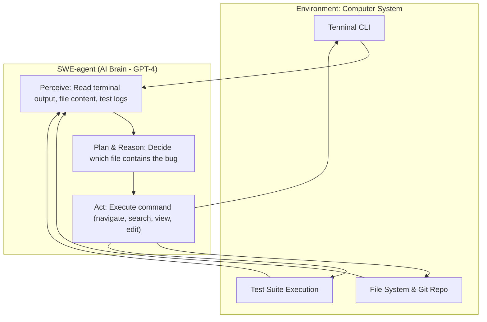
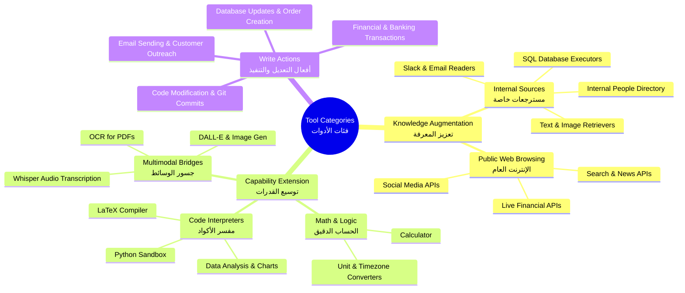
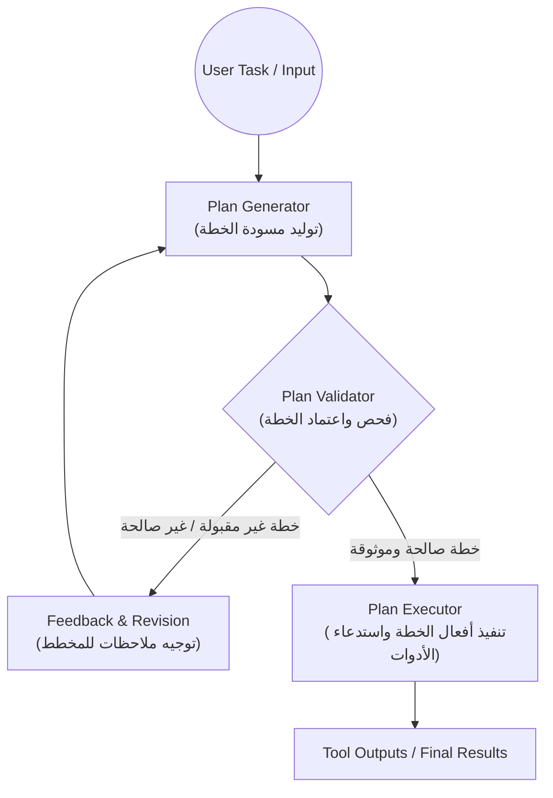
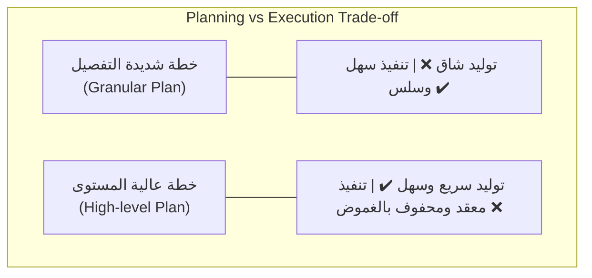
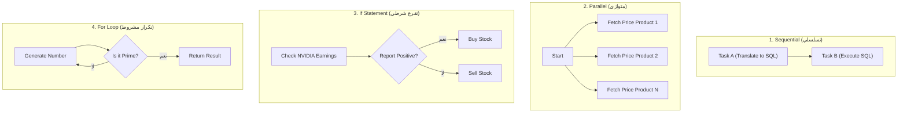
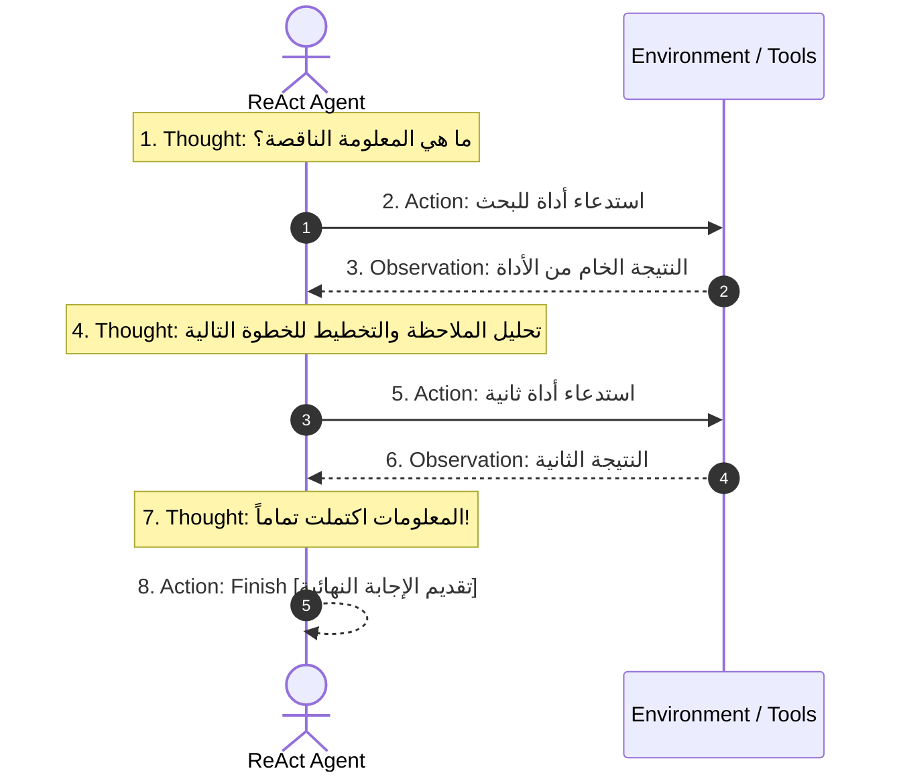

# الفصل 6 — الجزء 2: الوكلاء الأذكياء — الـ Agents (`ص 275–300`)

> **ملاحظة:** هذه الملاحظات شرح تفصيلي صفحة بصفحة بأسلوب شخصي بالعامية المصرية مع الحفاظ على المصطلحات التقنية بالإنجليزية. أرقام الصفحات مطابقة تماماً لترقيم الكتاب المطبوع.

<BatchQuickNav
  :batches="[
    { label: 'الدفعة 6', anchor: '#batch-6', pages: '275–281' },
    { label: 'الدفعة 7', anchor: '#batch-7', pages: '282–288' },
    { label: 'الدفعة 8', anchor: '#batch-8', pages: '288–293' },
    { label: 'الدفعة 9', anchor: '#batch-9', pages: '293–300' }
  ]"
/>

---

## الدفعة 6: مدخل الوكلاء الذاتيين والأدوات (`ص 275–281`) {#batch-6}

> **افتتاحية الجزء الثاني:** بعد أن انتهينا من استرجاع البيانات وبناء السياق (RAG)، ننتقل الآن إلى الأفق الأكبر والأكثر إثارة في هندسة الذكاء الاصطناعي: **الوكلاء الأذكياء (`AI Agents`)**. كيف يتحول الموديل من مجرد "شات بوت" يجيب على الأسئلة، إلى "كيان برمجى مستقل" يدرك بيئته، يمتلك أدواته الخاصة، ويؤتمت مهام معقدة في العالم الحقيقي نيابة عنا؟

---

### صفحة 275 — الهدف الأسمى للذكاء الاصطناعي (`The Ultimate Goal of AI`)

في نهاية صفحة 275، تفتح الكاتبة **Chip Huyen** الباب بتأكيد تاريخي مهم:
الكتاب الكلاسيكي الأشهر في تاريخ علوم الذكاء الاصطناعي للأستاذين **Stuart Russell** و **Peter Norvig** (*Artificial Intelligence: A Modern Approach - 1995*) يُعرّف أبحاث الذكاء الاصطناعي برمتها بأنها:
> *"The study and design of rational agents"*
> (دراسة وتصميم الوكلاء العقلانيين).

أي أن فكرة الـ **Agent** ليست "تريند" عابر ظهر مع ChatGPT، بل هي الغاية الكبرى والأصلية التي أُنشئ من أجلها علم الذكاء الاصطناعي منذ البداية!

#### ما الذي تغير اليوم؟
القدرات غير المسبوقة لـ **Foundation Models** الحديثة (فهم التعليمات، الاستدلال المنطقي، واستخراج المخرجات المنظمة) هي التي جعلت من الممكن لأول مرة بناء وكلاء أذكياء ذاتيي التشغيل (`Autonomous Intelligent Agents`) يقومون بأدوار:
- **المساعد الشخصي (`Assistant`):** حجز رحلات، إدارة التقويم، كتابة الرسائل.
- **زميل العمل (`Coworker`):** كتابة أكواد برمجية كاملة، إجراء أبحاث تسويقية، إدخال بيانات، وتحليل تقارير مالية.
- **المدرب (`Coach`):** تدريب المستخدمين على المقابلات الوظيفية، تعليم لغات، والتفاوض.

---

### صفحة 276 — ما هو الـ Agent تحديداً؟ البيئة والأفعال (`Environment & Actions`)

في الأوساط الهندسية، استخدم مصطلح "Agent" في سياقات كثيرة متباينة (Software Agent, User Agent, Conversational Agent, RL Agent). فما هو التعريف الصارم له؟

> [!TIP] التعريف المعياري للوكيل (`Agent Definition`)
> **الـ Agent هو أي كيان يدرك بيئته من خلال المستشعرات (`Perceives via Sensors`) ويتصرف في تلك البيئة من خلال المؤثرات/المحركات (`Acts via Actuators`).**
> وبالتالي، يتميز كل Agent بركنين لا ينفصلان:
> 1. **البيئة التي يعمل فيها (`Environment`):** يحددها الاستخدام المطلوب (`Use Case`).
> 2. **مجموعة الأفعال التي يستطيع القيام بها (`Set of Actions`).**

#### 1) البيئة تحدد الأفعال الممكنة
البيئة هي الملعب الذي يعيش فيه الوكيل:
- لو الـ Agent مصمم للعب الشطرنج أو Go أو Dota: فاللعبة وقواعدها هي بيئته، والأفعال المتاحة هي الحركات المشروعة داخل اللعبة فقط.
- لو الـ Agent روبوت طهي: المطبخ هو بيئته، والأفعال هي تقطيع الخضار وتشغيل الموقد.
- لو الـ Agent سيارة ذاتية القيادة (`Self-Driving Car`): شبكة الطرق والمشاة والإشارات هي بيئتها، والتوجيه والفرامل وزيادة السرعة هي أفعالها.
- لو الـ Agent مصمم لكشط الإنترنت (`Scrape documents`): فالإنترنت هو بيئته.

#### 2) علاقة التبعية المتبادلة بين البيئة والأدوات (`Environment-Tool Dependency`)
- **البيئة تحدد الأدوات المحتملة:** لا معنى لإعطاء وكيل الشطرنج أداة لتصفح الويب!
- **ترسانة الأدوات تقيّد بيئة الوكيل:** لو الروبوت كل أفعاله تنحصر في "السباحة"، فهو مقيد حتماً بالبيئات المائية (`Water Environment`) ولا يمكنه العمل على اليابسة.

#### 3) النماذج اليوم كـ Agents مبكرة
أغلب تطبيقات الـ GenAI التي نتعامل معها يومياً هي وكلاء (`Agents`) يمتلكون أدوات بسيطة:
- **ChatGPT هو Agent:** بيئته واجهة المحادثة + الإنترنت، وأفعاله هي البحث في الويب، تنفيذ كود بايثون، وتوليد الصور عبر DALL-E.
- **أنظمة الـ RAG هي Agents:** تمتلك أدوات استرجاع نصوص (`Text Retriever`)، صور (`Image Retriever`)، ومنفذ استعلامات (`SQL Executor`).

---

### صفحة 277 — دراسة حالة: عميل البرمجة `SWE-agent` وتدفق اتخاذ القرار

#### 1) عميل هندسة البرمجيات `SWE-agent` (Yang et al., 2024 — `Figure 6-8`)
يُعد **SWE-agent** (المبني فوق GPT-4) نموذجاً ساطعاً لكيفية تطبيق مفهوم الـ Agent في البرمجة:
- **بيئته (`Environment`):** جهاز الكمبيوتر بالكامل (شاشة الـ Terminal ونظام الملفات `File System`).
- **مجموعة أفعاله (`Actions / Tools`):**
  - تصفح المستودع البرمجي (`Navigate repo`).
  - البحث في الملفات والأكواد (`Search files`).
  - فتح واستعراض محتويات الملفات (`View files`).
  - تعديل واستبدال أسطر محددة في الكود (`Edit lines`).
  - تشغيل الاختبارات (`Run tests`).



#### 2) الـ AI هو العقل الموجه (`The Brain`)
في أي AI Agent، يلعب نموذج الذكاء الاصطناعي دور "المخ":
1. يستقبل مدخلات ومهمة المستخدم (`Task`).
2. يستقبل التغذية الراجعة والنتائج من البيئة (`Feedback / Tool Outputs`).
3. يخطط لسلسلة من الأفعال للوصول للهدف (`Plan sequence of actions`).
4. يُقيّم متى تم إنجاز المهمة بنجاح للتوقف (`Determine task completion`).

#### 3) مثال Kitty Vogue يتحول من RAG إلى Agent (سلسلة الـ 8 خطوات)
بالعودة لمتجر القطط الخيالي، لو دخل المدير وسأل سؤالاً استراتيجياً:
> **"توقع لي إيرادات مبيعات قبعة Fruity Fedora خلال الشهور الثلاثة القادمة؟"**
> *"Project the sales revenue for Fruity Fedora over the next three months."*

النظام هنا لا يكتفي باستعلام SQL واحد، بل ينفذ **سلسلة تفكير وتنفيذ ديناميكية** من 8 خطوات:
1. **التفكير (`Reasoning`):** الموديل يفكر أولاً: للتنبؤ بالمستقبل، أحتاج أرقام المبيعات التاريخية لآخر 5 سنوات.
2. **استدعاء أداة 1:** توليد استعلام SQL لجلب مبيعات السنوات الخمس الماضية.
3. **تنفيذ الأداة 1:** تشغيل استعلام الـ SQL واستخراج الأرقام.
4. **التفكير في النتيجة (`Reason on output`):** الموديل يلاحظ أن هناك شهوراً فيها أرقام ناقصة أو شاذة، فيقرر أنه بحاجة أيضاً لمعرفة مواعيد وميزانيات الحملات التسويقية السابقة.
5. **استدعاء أداة 2:** توليد استعلام SQL لجلب بيانات الحملات التسويقية.
6. **تنفيذ الأداة 2:** تشغيل الاستعلام.
7. **التفكير والدمج:** الموديل يرى أن المعلومات أصبحت كافية ومكتملة، فيجري عملية الحساب والتوقع المستقبلي.
8. **الإنهاء:** يقرر الموديل أن المهمة اكتملت ويقدم التقرير النهائي للمستخدم.

---

### صفحة 278 — لماذا تتطلب الـ Agents أقوى النماذج؟ (`Compound Mistakes`)

لماذا نستخدم دائماً أقوى النماذج المتاحة في السوق (مثل GPT-4o أو Claude 3.5 Sonnet) كعقول للـ Agents؟
تحدد Chip Huyen سببين جوهريين:

#### 1) خطورة الأخطاء التراكمية المركبة (`Compound Mistakes`)
في الشات العادي (خطوة واحدة)، لو دقة الموديل $95\%$ فالنتيجة ممتازة.
أما في الـ Agents، إنجاز المهمة يتطلب سلسلة خطوات متعاقبة ($n$ steps)، وكل خطوة تعتمد مخرجاتها على صحة الخطوة التي سبقتها.

رياضياً، إذا كانت دقة الموديل في الخطوة الواحدة هي $p = 0.95$:
- على مدى **10 خطوات**:
  $$\text{Accuracy}_{\text{overall}} = (0.95)^{10} \approx 0.5987 \quad (\approx 60\%)$$
- على مدى **20 خطوة**:
  $$\text{Accuracy}_{\text{overall}} = (0.95)^{20} \approx 0.3584 \quad (\approx 36\%)$$
- على مدى **100 خطوة**:
  $$\text{Accuracy}_{\text{overall}} = (0.95)^{100} \approx 0.0059 \quad (\approx 0.6\%)$$

> [!WARNING] قانون تناقص دقة الوكلاء
> مع زيادة عدد الخطوات، تنحدر الدقة الكلية للنظام بسرعة دراماتيكية! خطأ واحد صغير في الخطوة رقم 3 قد يقود الوكيل إلى تيه كامل وحلقات لا نهائية في الخطوات التالية؛ لذا يحتاج الوكيل لأعلى نماذج الاستدلال دقة وقدرة على التعافي الذاتي من الأخطاء.

#### 2) ارتفاع سقف المخاطر (`Higher Stakes`)
في الاستخدامات العادية، أقصى فشل هو نص غير دقيق في الشاشة. أما عندما يمتلك الوكيل أدوات حقيقية في بيئة عملك، فإن الفشل قد يعني:
- حذف جداول من قاعدة بيانات الإنتاج.
- إرسال بريد إلكتروني غير لائق لعملاء كبار.
- تحويل أموال لحسابات خاطئة.

#### تكلفة تشغيل الـ Agents
تتطلب مهام الوكلاء استدعاءات متكررة للموديل، مما قد يستهلك رصيد الـ API بسرعة (*"Agents are only good for burning through your API credits"* كما كان يُقال في البدايات). لكن إذا نجح الوكيل في العمل باستقلالية وموثوقية، فإن ما يوفره من آلاف الساعات البشرية يجعل تكلفة الـ API ضئيلة للغاية مقارنة بالقيمة الاقتصادية الناتجة.

---

### صفحة 278–279 — تصنيف الأدوات (`Tools`): تعزيز المعرفة والقدرات

الأدوات (`Tools`) هي الركيزة التي تمكّن الوكيل من **الإدراك (`Perceive - Read`)** و**الفعل (`Act - Write`)**.
مجموعة الأدوات المتاحة للوكيل تسمى **ترسانة أدواته (`Tool Inventory`)**.
تقسم Chip Huyen الأدوات إلى **ثلاث فئات رئيسية**:



---

#### 1) أدوات تعزيز المعرفة (`Knowledge Augmentation`)
هدفها تزويد الموديل بالسياق والمعلومات الدقيقة قبل اتخاذ القرار:
- **أدوات المؤسسة الداخلية:** مسترجعات نصوص، صور، جداول مبيعات SQL، رسائل Slack، بريد إلكتروني، ودليل موظفي الشركة (`Internal People Search`).
- **تصفح الإنترنت (`Web Browsing`):**
  - يمنع النموذج من أن يصبح قديماً متقادماً (**Prevents a model from going stale**).
  - إذا انتهت بيانات تدريب النموذج الأسبوع الماضي، فلن يعرف شيئاً عن أحداث اليوم أو أسعار الأسهم أو حالة الطقس أو تذاكر الطيران إلا عبر تصفح الويب واستدعاء APIs البحث الحية (Search APIs, News, GitHub, Reddit).
  - **تنبيه أمني وبياناتي:** كما يمنح الويب الموديل معلومات حية، فإنه قد يعرضه لمستنقعات الإنترنت والمعلومات المضللة والمسمومة؛ لذا يجب انتقاء مصادر البيانات الخارجية بحذر.

---

### صفحة 279–280 — توسيع القدرات (`Capability Extension`) ومفسر الأكواد

#### 2) أدوات توسيع القدرات الذاتية (`Capability Extension`)
تعالج هذه الأدوات نقاط الضعف الفطرية في النماذج اللغوية، وتمنحها دفعة أداء هائلة دون الحاجة لإعادة تدريبها:

##### أ) الأدوات الحسابية البسيطة:
النماذج اللغوية سيئة بطبيعتها في الحسابات الحسابية الصارمة (مثلاً: ما حاصل قسمة $199,999 \div 292$؟).
- بدلاً من إهدار ملايين الدولارات لتدريب الموديل على الحساب، من الأوفر والأذكى بكثير منحه **آلة حاسبة (`Calculator`)**.
- أدوات بسيطة تصنع فارقاً خارقاً: التقويم (`Calendar`)، محول المناطق الزمنية (`Timezone Converter`)، ومحول الوحدات (`Unit Converter` من رطل لكيلوجرام).

##### ب) مفسر الأكواد (`Code Interpreters`):
أحد أقوى الأسلحة في يد الوكيل الذكي:
- بدلاً من أن يخمّن الموديل ناتج كود في رأسه، يكتب كود بايثون ويرسله لمفسر الأكواد، فيتم تنفيذه داخل Sandbox آمن، وتعود النتيجة الرقمية أو رسالة الخطأ للموديل ليتعلم منها ويصلح كوده.
- يتيح هذا للوكلاء العمل كمساعدي برمجة، محللي بيانات (`Data Analysts`)، وباحثين علميين يجرون التجارب ويرسمون المخططات البيانية.
- **تنبيه أمني حاسم:** التنفيذ الآلي للكود ينطوي على مخاطر **هجمات حقن الأكواد (`Code Injection`)**؛ لذا يُشترط تشغيله في بيئات معزولة تماماً (`Sandboxed Containers`) بصلاحيات محدودة جداً.

##### ج) جسور الوسائط المتعددة (`Multimodal Bridges`):
الأدوات تجعل الموديل أحادي الوسائط (نصي فقط) يعمل كنظام متعدد الوسائط:
- نموذج نصي يستدعي `DALL-E` لتوليد صور.
- نموذج نصي يستدعي `Matplotlib` لرسم شارتات، أو `LaTeX` لكتابة معادلات، أو متصفحاً لعرض كود `HTML`.
- نموذج نصي يستدعي أداة `OCR` لقراءة الـ PDFs، أو أداة `Audio Transcription` لسماع الصوتيات.

##### د) إثبات تجريبي: نموذج `Chameleon` (Lu et al., 2023)
ورقة بحثية رائدة أثبتت أن تزويد GPT-4 بـ 13 أداة (توليد استعلامات، استرجاع نصوص، كشف صور، وبحث Bing) تفوق على GPT-4 بمفرده تفوقاً كاسحاً:
- في اختبار **ScienceQA** للأسئلة العلمية: تحسنت الدقة بمقدار **$+11.37\%$**.
- في اختبار **TabMWP** للمسائل الرياضية الجدولية: تحسنت الدقة بمقدار **$+17\%$**.

---

### صفحة 280–281 — أفعال الكتابة والتعديل (`Write Actions`) وإشكالية الأمان

#### 3) أفعال الكتابة والتعديل في العالم الحقيقي (`Write Actions`)
حتى هذه اللحظة، ركزنا على أفعال "القراءة فقط" (`Read-only`). لكن القوة الكاملة للوكيل تتفجر عندما يمتلك القدرة على **إحداث تغيير حقيقي في البيئة (`Write Actions`)**:
- استعلام الـ SQL يمكنه قراءة جدول، لكن يمكنه أيضاً تعديل صفوفه أو حذفه.
- واجهة البريد الإلكتروني تقرأ الرسائل الواردة، لكنها تستطيع أيضاً إرسال الردود.
- واجهة البنك تقرأ الرصيد، لكنها تستطيع أيضاً تنفيذ تحويلات مالية وسحب أموال.

#### أتمتة دورات الأعمال بالكامل (`End-to-End Automation`)
أفعال الكتابة تسمح لك بأتمتة دورة عمل كاملة لمسؤولي المبيعات (`Sales Outreach`):
1. البحث عن عملاء محتملين في الويب.
2. استخراج بيانات التواصل والتأكد منها.
3. صياغة الإيميل الأول وتخصيصه لكل عميل.
4. إرسال الإيميل وقراءة الردود الواردة.
5. المتابعة التلقائية وتحديث قاعدة البيانات بالطلبات المؤكدة.

#### إشكالية الأمان والثقة (`Trust, Safety & Security`)
لكن إعطاء الذكاء الاصطناعي صلاحية تعديل العالم الحقيقي يثير مخاوف حقيقية:
> [!CAUTION] حكمة إدارية وهندسية
> كما أنك لا تمنح متدرباً جديداً في أسبوعه الأول صلاحية الدخول ومسح قاعدة بيانات الإنتاج (`Production DB`)، لا ينبغي أبداً منح وكيل ذكاء اصطناعي غير موثوق الصلاحية المطلقة لإجراء تحويلات بنكية أو حذف ملفات حساسة.
> الثقة تُبنى بالتجربة، وبالضوابط الأمنية الصارمة (`Guardrails & Permissions`).

تستشهد الكاتبة بنقاشات السيارات ذاتية القيادة: الخوف من القرصنة موجود، لكن في الواقع أجهزة الذكاء الاصطناعي قادرة على إلحاق ضرر واسع دون وجود جسدي مادي (التلاعب بالبورصة، سرقة الملكية الفكرية، انتهاك الخصوصية، وترويج الشائعات). ومع تطور معايير الأمان، سنصل إلى درجة ثقة كافية تجعل فوائد الوكلاء تعم العالم، تماماً كما وثق البشر في الآلات التي تنقلهم للفضاء.

#### استدعاء الدوال (`Function Calling`)
دعمت كبرى شركات النماذج هذه الرؤية رسمياً من خلال خاصية **Function Calling**، حيث يحدد المطور أدواته بصيغة `JSON Schema`، ويقرر الموديل متى يستدعي الأداة، وما هي المعاملات (`Arguments`) المطلوبة بدقة متناهية.

---

<QuickFlashcards
  title="مراجعة سريعة — الدفعة 6 (ص 275–281)"
  :cards="[
    {
      q: 'ما هو تعريف الوكيل العقلاني (Rational Agent) وفقاً لكتاب Russell & Norvig؟',
      a: 'هو أي كيان يدرك بيئته المحيطة من خلال المستشعرات (Sensors) ويتصرف في تلك البيئة من خلال المؤثرات والمحركات (Actuators).'
    },
    {
      q: 'لماذا تنحدر دقة الوكلاء بسرعة عند زيادة عدد الخطوات (Compound Mistakes)؟',
      a: 'لأن احتمالية النجاح الكلي هي حاصل ضرب دقة كل خطوة على حدة: فإذا كانت دقة الخطوة 95%، فإن الدقة الإجمالية تنخفض إلى 60% بعد 10 خطوات، وإلى 0.6% بعد 100 خطوة.'
    },
    {
      q: 'ما هي الفئات الثلاث الرئيسية للأدوات في ترسانة الوكيل (Tool Inventory)؟',
      a: '1) تعزيز المعرفة (Knowledge Augmentation مثل RAG وتصفح الويب)، 2) توسيع القدرات (Capability Extension مثل الآلة الحاسبة ومفسر بايثون)، 3) أفعال الكتابة والتنفيذ (Write Actions مثل إرسال الإيميلات وتعديل قواعد البيانات).'
    },
    {
      q: 'كيف ساعدت ترسانة الأدوات نموذج Chameleon على التفوق على GPT-4 الأصلي؟',
      a: 'من خلال تزويده بـ 13 أداة خارجية (بحث، حساب، كشف صور)، مما رفع دقته بنسبة +11.37% في الأسئلة العلمية ScienceQA، وبنسبة +17% في المسائل الرياضية الجدولية TabMWP.'
    },
    {
      q: 'ما هو الخطر الرئيسي المصاحب لأفعال الكتابة (Write Actions) وكيف يتم التعامل معه؟',
      a: 'الخطر هو إحداث تغييرات كارثية غير قابلة للإلغاء في العالم الحقيقي (حذف بيانات، تحويل أموال)؛ ويتم التعامل معه عبر بيئات معزولة (Sandboxes)، ضوابط صلاحيات دقيقة، وحواجز أمان (Guardrails).'
    }
  ]"
/>

<BatchCheck id="ch06-b6" label="الدفعة 6 (ص 275–281): Agent Overview & Tools (SWE-agent, Compound Mistakes, Tool Inventory, Write Actions)" />

---

## الدفعة 7: التخطيط — تفكيك المهام واستدعاء الدوال (`ص 282–288`) {#batch-7}

> **محور الدفعة:** إعطاء الموديل ترسانة من الأدوات لا يكفي وحده لجعله وكيلاً ذكياً ناجحاً؛ السؤال الأهم هو: **كيف يقرر الوكيل متى يستخدم كل أداة؟ وبأي ترتيب؟ وكيف يتعامل مع المهام الضخمة المعقدة؟** هنا ندخل إلى قلب الـ Agent: **محرك التخطيط (`The Planning Engine`)**.

---

### صفحة 282 — ما هو التخطيط؟ وتحدي كفاءة تفكيك المهام (`Task Decomposition`)

المهام المعقدة في الحياة الواقعية لا تُحل بضغطة زر واحدة، بل تتطلب **تخطيطاً (`Planning`)**.
- **مخرجات عملية التخطيط:** هي **الخطة (`Plan`)**، وهي عبارة عن خارطة طريق (`Roadmap`) تسرد الخطوات المنطقية المتتابعة المطلوبة لإنجاز المهمة.
- التخطيط الفعال يتطلب من النموذج:
  1. فهم المهمة بعمق (`Understand the task`).
  2. التفكير في مسارات وخيارات بديلة لتحقيقها (`Consider different options`).
  3. اختيار المسار الأكثر كفاءة وموثوقية (`Choose the most promising path`).

#### معضلة كفاءة تفكيك المهام: مثال الشركات والمليار دولار
أي مهمة يمكن تفكيكها بأكثر من طريقة، لكن ليست كل الطرق تؤدي للنجاح، وحتى الطرق الناجحة تتفاوت جداً في الكفاءة والتكلفة.
تطرح **Chip Huyen** مثالاً ذكياً:
تخيل استعلام المستخدم التالي:
> **"كم عدد الشركات التي ليس لها إيرادات إطلاقاً، وجمعت تمويلاً استثمارياً لا يقل عن مليار دولار؟"**
> *"How many companies without revenue have raised at least $1 billion?"*

هناك مساران منطقيان لحل هذا السؤال عبر الأدوات:
1. **المسار الأول:** ابحث عن كل الشركات التي ليس لها إيرادات أولاً، ثم فلتر تلك القائمة لمعرفة من منها جمع أكثر من مليار دولار.
2. **المسار الثاني:** ابحث عن كل الشركات التي جمعت تمويلاً لا يقل عن مليار دولار أولاً، ثم فلترها لمعرفة من منها بلا إيرادات.

> [!TIP] لماذا المسار الثاني هو اختيار الوكيل الذكي؟
> في عالم الأعمال، هناك **ملايين الشركات الناشئة والصغيرة التي ليس لها أي إيرادات**؛ البحث عنها وتخزينها سيتطلب ملايين العمليات ويغرق ذاكرة النظام.
> بينما الشركات التي نجحت في جمع **أكثر من مليار دولار** هي فئة نادرة ومعدودة جداً (عشرات أو مئات الشركات على الأكثر).
> فلترة مجموعة صغيرة جداً أسرع بآلاف المرات وأوفر في الموارد من فلترة محيط ضخم من البيانات. **الوكيل الذكي الحقيقي يختار المسار رقم 2 فوراً!**

---

### صفحة 282–283 — فصل التخطيط عن التنفيذ (`Decoupling Planning & Execution`)

#### لماذا يُعد دمج التخطيط مع التنفيذ فخاً هندسياً؟
في الـ Prompts العادية، قد نطلب من الموديل التفكير خطوة بخطوة والتنفيذ فوراً في نفس الوقت (مثل Chain-of-Thought التقليدي).
لكن ماذا لو ألّف الموديل في خياله خطة من 100 خطوة عبثية لا توصل للهدف إطلاقاً؟
- بدون رقابة، سيبدأ الوكيل في استدعاء الـ APIs وتشغيل الأكواد خطوة وراء خطوة لساعات طويلة، فيحرق آلاف الدولارات في استدعاءات النماذج والـ Cloud، دون أن يدرك أحد أنه يسير في طريق مسدود!

#### الحل: بنية المنظومة ثلاثية المكونات (`Figure 6-9`)
لتجنب التنفيذ العبثي للخطط الفاشلة، تقترح الكاتبة مبدأً معمارياً صارماً: **افصل التخطيط عن التنفيذ تماماً (`Decouple Planning from Execution`)**.



تنقسم المنظومة إلى 3 مكونات متمايزة (تُشكل معاً **Multi-Agent System**):
1. **مولد الخطة (`Plan Generator`):** يستقبل طلب المستخدم ويفككه إلى مسودة خطوات أولية.
2. **مراجع ومتحقق الخطة (`Plan Validator`):** يفحص الخطة للتأكد من صلاحيتها قبل إنفاق سنت واحد في التنفيذ، باستخدام نوعين من الفلاتر:
   - **فلاتر استدلالية سريعة (`Heuristics`):** مثل التأكد من عدم وجود أدوات وهمية (لو الخطة تطلب استدعاء بحث Google والوكيل لا يملك هذه الأداة، تُرفض الخطة فوراً)، أو رفض الخطط التي تتجاوز عدداً معيناً من الخطوات ($X$ steps).
   - **قضاة الذكاء الاصطناعي (`AI Judges`):** موديل آخر يُقيّم هل الخطة معقولة ومنطقية أم تحتاج تحسيناً.
3. **منفذ الخطة (`Plan Executor`):** يستلم الخطة بعد اعتمادها ويبدأ في استدعاء الأدوات الفعلية عبر الـ Function Calling.

> **توليد الخطط بالتوازي (`Parallel Plan Generation`):**
> لتسريع زمن الاستجابة، يمكن للوكيل توليد 3 أو 4 خطط بديلة في نفس اللحظة بالتوازي، ويقوم الـ Validator باختيار الأفضل والأرخص بينها (مقايضة واضحة بين زيادة تكلفة الـ Tokens وتقليل الـ Latency).

---

### صفحة 283–284 — تصنيف النوايا (`Intent Recognition`) والرقابة البشرية

#### 1) مصنف النوايا (`Intent Classifier`): عقل التوجيه الأولي
التخطيط الناجح يبدأ من فهم دقيق لما يريده المستخدم خلف السطور:
- لو كان طلب العميل في الدعم الفني متعلقاً بـ "الفواتير والخصومات"، فالوكيل يحتاج لأداة استرجاع سجل المدفوعات والـ Stripe API.
- لو كان الطلب متعلقاً بـ "إعادة تعيين كلمة المرور"، فالوكيل يحتاج للبحث في وثائق المساعدة وسياسات الأمان.

> [!IMPORTANT] تصفية الطلبات الخارجة عن النطاق (`IRRELEVANT Requests`)
> بعض الاستفسارات تكون خارج تخصص الوكيل تماماً (مثلاً: سؤال شات خدمة عملاء متجر عن رأيه في مباراة كرة قدم).
> يجب أن يمتلك مصنف النوايا القدرة على تصنيف الطلب كـ `IRRELEVANT` ليرفضه النظام بلباقة وسرعة، بدلاً من إهدار الـ Compute والـ FLOPs في محاولة وضع خطط مستحيلة لمشاكل خارجة عن اختصاصه!

---

#### 2) الرقابة البشرية ومستويات الأتمتة (`Human-in-the-Loop`)
الافتراض بأن الوكيل سيعمل بنسبة $100\%$ آلياً طوال الوقت أمر غير واقعي في بيئات العمل الحساسة. البشر يمكنهم التدخل في المحطات الثلاث:
- **في التخطيط:** إذا كانت المهمة معقدة جداً، يقدم الخبير البشري إطاراً عاماً عالي المستوى (`High-level plan`)، ويترك للوكيل تفكيك التفاصيل الدقيقة وتنفيذها.
- **في المراجعة:** يفحص المهندس البشري مسار الخطة ويعدل خطواتها.
- **في التنفيذ:** للأفعال شديدة الخطورة (مثل حذف قاعدة بيانات، دمج كود في الـ Main branch، أو إرسال تحويلات مالية ضخمة)، يتوقف النظام ويطلب **موافقة بشرية صريحة (`Explicit Human Approval`)** قبل الضغط على الزر.

---

#### 3) الدورة المتكاملة لحل المهام (`The 4-Step Resolution Cycle`)
تلخص Chip Huyen الدورة الكاملة لحل المهام في 4 مراحل متعاقبة:
1. **توليد الخطة (`Plan Generation`):** ابتكار تسلسل أفعال قابل للتنفيذ (تفكيك المهمة).
2. **التأمل وتصحيح الخطة (`Reflection & Error Correction`):** فحص الخطة وتعديلها إذا وُجدت ثغرات.
3. **التنفيذ (`Execution`):** استدعاء الأدوات والدوال وتطبيق الأفعال المحددة.
4. **التأمل في المخرجات (`Reflection on Outcomes`):** فحص النتائج الراجعة من الأدوات للتأكد من اكتمال الهدف؛ وإن لم يكتمل، يتم توليد خطة تصحيحية جديدة.

---

### صفحة 284–285 — الجدل الكبير: هل النماذج اللغوية قادرة حقاً على التخطيط؟

تطرح الكاتبة واحدة من أعمق النقاشات الفلسفية والتقنية الدائرة حالياً بين كبار علماء الذكاء الاصطناعي:

#### 1) معسكر المشككين: "النماذج التتابعية لا تخطط!"
- **يان ليكون (Yann LeCun — كبير علماء الذكاء الاصطناعي في Meta 2023):**
  يؤكد بشكل قاطع أن النماذج اللغوية التوليدية القائمة على التنبؤ بالرمز التالي (`Autoregressive LLMs`) **عاجزة بنيوياً عن التخطيط الحقيقي**.
- **سوباراو كامبهامباتي (Subbarao Kambhampati 2023 — ورقة Can LLMs Really Reason and Plan?):**
  يرى أن الأبحاث التي تدعي قدرة الموديلات على التخطيط تخلط بين شيئين:
  - استرجاع المعرفة العامة للتخطيط المخزنة في بطون النصوص (`Planning Knowledge Extraction`).
  - التخطيط التنفيذي الحقيقي الخالي من الأخطاء (`Executable Planning`).
  فالموديل قد يكتب خطة تبدو "مقنعة وجميلة في صياغتها" للشخص العادي، لكنها عند محاولة تشغيلها برمجياً تنهار وتصطدم بالأخطاء فوراً.

#### 2) تحليل Chip Huyen: لماذا يُعتبر التخطيط مسألة بحث (`Search Problem`)؟
التخطيط في علوم الحاسوب ليس مجرد توليد جمل، بل هو **مسألة بحث في فضاء الحالات (`State Space Search`)**:
- أنت تقف في حالة حالية ($S_0$) وتريد الوصول لحالة الهدف ($S_g$).
- تبحث بين مسارات بديلة، وتتوقع العائد/المكافأة (`Reward`) لكل مسار.
- **التراجع للخلف (`Backtracking`):** لو اخترت الفعل $A$ ودخلت في حالة سيئة مسدودة، يجب أن تمتلك القدرة على التراجع للوراء لتجربة الفعل $B$.

#### 3) هل النماذج عاجزة فعلاً، أم ينقصها "نموذج العالم" (`World Model`)؟
ترد الكاتبة بنظرة متفائلة مدعومة بالأوراق العلمية:
- **الموديل يستطيع التراجع (`Backtracking`):** لو جرب الموديل مساراً واكتشف فشله، يمكنه في الخطوة التالية تعديل خطته والبدء من جديد وتجربة مسار آخر.
- **الحلقة المفقودة الحقيقية:** الموديل يفشل في التخطيط لأنه لا يُمنح الأدوات الكافية لـ **توقع نتيجة كل فعل (`Predict Outcome of Action`)**.
  - مثال الجبل: لو كنت تسير في جبل وأمامك 4 خيارات (يمين، يسار، أمام، استدارة). لا يمكنك الاختيار بمجرد رؤية الخيارات؛ لو كان "اليمين" سيقودك للسقوط من الهاوية، فلن تختاره. لمعرفة هل تتخذ الفعل أم لا، يجب أن تعرف **الحالة الناتجة عنه مسبقاً**.
- **ورقة بحثية حاسمة (Hao et al., 2023):**
  *"Reasoning with Language Model is Planning with World Model"*
  تثبت أن النماذج اللغوية، بما تحويه من معارف هائلة عن العالم، قادرة على العمل كـ **World Model** يتوقع النتائج المحتملة للأفعال لتوليد خطط متماسكة، خاصة إذا دُمجت مع أنظمة تتبع الحالة (`State Tracking`) وخوارزميات البحث التراجعي.

---

### صفحة 286 — النماذج الأساسية (`FM`) مقابل التعلم التعزيزي (`RL`)

يُعد الوكيل (`Agent`) مفهوماً أصيلاً وتاريخياً في حقل **التعلم التعزيزي (Reinforcement Learning - RL)**.
فكيف يقارن مخطط النماذج الأساسية (`FM Planner`) بمخطط الـ RL الكلاسيكي؟

| وجه المقارنة | مخطط التعلم التعزيزي الكلاسيكي (`RL Planner`) | مخطط النماذج الأساسية الحديثة (`FM Planner`) |
| :--- | :--- | :--- |
| **تعريف الوكيل والبيئة** | متطابق: بيئة، مستشعرات، ومجموعة أفعال مشروعة. | متطابق: بيئة، مستشعرات، ومجموعة أفعال مشروعة. |
| **آلية تدريب المخطط** | يتطلب تدريباً شاقاً بخوارزميات RL وملايين المحاولات والخطأ. | النموذج اللغوي نفسه هو المخطط الجاهز، مستفيداً من معارفه المسبقة. |
| **استهلاك الموارد والزمن** | مكلف جداً في الحوسبة وصياغة دوال المكافأة (`Reward Functions`). | أسرع بكثير وأقل استهلاكاً للموارد عبر الـ Prompting والـ Finetuning. |
| **المرونة اللغوية** | مقيد بفضاء أفعال وحالات رياضي صلب ومحدد مسبقاً. | مرن للغاية ويتعامل مع المهام والتعليمات بلغة طبيعية مفتوحة. |
| **مستقبل التقنية** | يتكامل مع النماذج التوليدية. | يتوقع اندماج النمطين معاً في المدى الطويل (**FM + RL Convergence**). |

---

### صفحة 286–287 — توليد الخطط بالبرومبت ومعضلة المعاملات الديناميكية

أبسط طريقة لتحويل النموذج لمولد خطط هي هندسة التعليمات (`Prompt Engineering`):

#### 1) نموذج البرومبت لتوليد الخطط (مثال Kitty Vogue)
```text
SYSTEM PROMPT:
Propose a plan to solve the task. You have access to 5 actions:
- get_today_date()
- fetch_top_products(start_date, end_date, num_products)
- fetch_product_info(product_name)
- generate_query(task_history, tool_output)
- generate_response(query)

The plan must be a sequence of valid actions.

Examples:
Task: "Tell me about Fruity Fedora"
Plan: [fetch_product_info, generate_query, generate_response]

Task: "What was the best selling product last week?"
Plan: [fetch_top_products, generate_query, generate_response]

Task: "What's the price of the best-selling product last week?"
Plan:
```

الخطة الناتجة ستكون:
1. `get_today_date()`
2. `fetch_top_products()`
3. `fetch_product_info()`
4. `generate_query()`
5. `generate_response()`

---

#### 2) معضلة المعاملات الديناميكية (`Dynamic Parameters Dilemma`)
قد تسأل: **لماذا لم يكتب الموديل المعاملات (Arguments) لكل دالة مسبقاً في الخطة؟**
- السبب الهندسي الحاسم: **معاملات الخطوة القادمة تعتمد كلياً على مخرجات الخطوة السابقة!**
- في البداية، الموديل لا يعرف تاريخ اليوم، فكيف سيعرف تاريخ "الأسبوع الماضي"؟
- بعد تشغيل `get_today_date()` وظهور الناتج `2030-09-13`، يستطيع الوكيل استنتاج معاملات الخطوة التالية بدقة:
  ```python
  retrieve_top_products(
      start_date="2030-09-07",
      end_date="2030-09-13",
      num_products=1
  )
  ```

#### مخاطر التخمين والهلوسة
في كثير من الأحيان، تكون معلومات المستخدم ناقصة ومبهمة:
- لو قال المستخدم: *"ما هو متوسط أسعار المنتجات الأكثر مبيعاً؟"*
  - كم منتج يقصد؟ أفضل 3 أم أفضل 10 أم أفضل 50؟
  - هل يقصد الأكثر مبيعاً هذا الأسبوع أم هذا الشهر أم على مدار التاريخ؟
- يضطر الموديل للتخمين، والتخمين قد يؤدي إلى استدعاء دوال غير صالحة أو تمرير قيم معاملات كارثية؛ وهنا تظهر أهمية الفلاتر والتحقق المسبق.

---

### صفحة 288 — الاستراتيجيات الخمس لتحسين التخطيط واستدعاء الدوال المعياري

#### 1) كيف تجعل وكيلك مخططاً بارعاً؟ (5 استراتيجيات مجربة)
1. **تحسين الـ System Prompt:** تزويد الموديل بأمثلة متنوعة ومحكمة (`Few-shot examples`) تشمل حالات شاذة.
2. **شرح الأدوات ومعاملاتها بعناية فائقة:** كتابة `Docstrings` و `Descriptions` شديدة الوضوح تشرح ماذا تفعل الدالة بدقة وماذا تعني كل خانة.
3. **تبسيط وإعادة هيكلة الدوال برمجياً (`Refactoring`):** لو كانت لديك دالة معقدة تقوم بمهام متشابكة، فككها إلى دالتين بسيطتين مستقلتين يسهل على الموديل فهمهما واستدعاؤهما.
4. **استخدام نماذج استدلال أقوى (`Stronger Models`):** النماذج الأكبر والأحدث بطبيعتها تتفوق في رسم المسارات وحساب التبعيات المنطقية.
5. **ضبط النموذج وتخصيصه (`Finetuning for Plan Generation`):** تدريب الموديل على بيانات أفعال وخطط سابقة خاصة ببيئة عملك.

---

#### 2) معمارية استدعاء الدوال القياسية (`Function Calling Standards`)
يقدم مزودو النماذج اليوم خاصية استدعاء الدوال كمعيار صناعي لتشغيل الوكلاء في خطوتين:
1. **إنشاء ترسانة الأدوات (`Declare Tool Inventory`):**
   تعريف كل أداة باسمها البرمجي، ومعاملاتها المطلوبة والأنواع (`Types`)، وتوصيف عملها بصيغة معيارية (`JSON Schema`).
2. **تحديد ضوابط الاستدعاء لكل استعلام (`Tool Choice Control`):**
   - `auto`: الموديل يمتلك كامل الحرية ليقرر بنفسه هل يستدعي أداة أم يجيب مباشرة بنص، ويختار الأداة الأنسب.
   - `required`: الموديل مُلزم إجبارياً باستدعاء أداة واحدة على الأقل قبل الإجابة.
   - `none`: يُحظر على الموديل استدعاء أي أداة ويُجبر على الاعتماد على معلوماته الداخلية فقط.

---

<QuickFlashcards
  title="مراجعة سريعة — الدفعة 7 (ص 282–288)"
  :cards="[
    {
      q: 'لماذا يُعد فصل التخطيط عن التنفيذ (Decoupling Planning and Execution) مبدأ هندسياً حاسماً؟',
      a: 'لتجنب تشغيل خطط فاشلة أو لا نهائية؛ فبدلاً من أن يبدأ الوكيل في استدعاء الـ APIs وحرق التكاليف في خطوات غير صالحة، يتم فحص الخطة واعتمادها أولاً بفلاتر استدلالية أو حكام AI قبل بدء التنفيذ.'
    },
    {
      q: 'ما هو الدور الحاسم لمصنف النوايا (Intent Classifier) في معمارية الوكلاء؟',
      a: 'تحديد ما يريده العميل بدقة لاختيار ترسانة الأدوات المناسبة للطلب، واستبعاد الاستفسارات الخارجة عن الاختصاص (IRRELEVANT) بلباقة لتوفير الموارد الحوسبية.'
    },
    {
      q: 'ما هو الانتقاد الرئيسي الذي وجهه يان ليكون وكامبهامباتي لقدرة النماذج اللغوية على التخطيط؟',
      a: 'أنهما يريان أن النماذج التتابعية تولد نصوصاً تبدو منطقية لكنها غير قابلة للتنفيذ كخطط حقيقية، وأن التخطيط الحقيقي يتطلب بحثاً وتراجعاً (Backtracking) وتوقعاً لنتائج الحالات وهو ما ينقص النماذج المجردة.'
    },
    {
      q: 'كيف تتفوق مخططات النماذج الأساسية (FM Planners) على مخططات التعلم التعزيزي (RL Planners) في التطبيقات؟',
      a: 'النماذج الأساسية تمتلك نموذجاً مسبقاً ومعارف واسعة عن العالم وتتعامل بلغة طبيعية مرنة وتتطلب وقتاً وموارد أقل بكثير، بينما خوارزميات RL الكلاسيكية تتطلب تدريباً شاقاً وصياغة معقدة لدوال المكافأة.'
    },
    {
      q: 'لماذا لا يمكن للموديل تحديد معاملات الدوال (Parameters) مسبقاً أثناء توليد الخطة؟',
      a: 'لأن معاملات أي خطوة تعتمد ديناميكياً على النتائج والمخرجات الفعلية التي ترجعها الأدوات في الخطوات السابقة (مثل حساب تواريخ الأسبوع الماضي بناءً على تاريخ اليوم المسترجع).'
    }
  ]"
/>

<BatchCheck id="ch06-b7" label="الدفعة 7 (ص 282–288): Planning (Task Decomposition, Decoupled Planning, FM vs RL, Dynamic Parameters & Function Calling)" />

---

## الدفعة 8: التخطيط المتقدم — تدفقات التحكم، ReAct، و Reflexion (`ص 288–294`) {#batch-8}

> **محور الدفعة:** بعد أن فهمنا أساسيات تفكيك المهام واستدعاء الدوال، نغوص الآن في البنية الهندسية العميقة للوكلاء: **ما مدى تفصيل الخطة؟ كيف يدير الوكيل تدفقات معقدة (توازي وتكرار وتفرع شرطي)؟ وكيف "يتأمل" الوكيل في أخطائه ويتعلم منها ذاتياً عبر أشهر نمطين في تاريخ الـ Agents: `ReAct` و `Reflexion`؟**

---

### صفحة 288–290 — مستويات تفصيل الخطة (`Planning Granularity`) والتخطيط الهرمي

الخطة في جوهرها خارطة طريق تسرد الخطوات اللازمة لإنجاز الهدف. لكن السؤال الهندسي المحوري: **ما مدى دقة وتفصيل هذه الخارطة؟**
- لو أردت التخطيط لعام كامل: الخطة ربع السنوية (`Quarter-by-quarter`) هي مستوى أعلى وأشمل (`Higher-level`) من الخطة الشهرية (`Month-by-month`)، والتي هي بدورها أعلى وأشمل من الخطة الأسبوعية (`Week-by-week`).

#### معضلة التخطيط مقابل التنفيذ (`Planning / Execution Trade-off`)
هناك مقايضة هندسية حتمية بين صعوبة توليد الخطة وصعوبة تنفيذها:
1. **الخطة شديدة التفصيل (`Detailed / Granular Plan`):**
   - **صعبة التوليد:** تتطلب من النموذج حساب كل خطوة صغيرة مسبقاً بدقة، مما يرفع احتمالية الخطأ والهلوسة.
   - **سهلة التنفيذ:** المنفذ لا يحتاج للتفكير؛ كل حركة محددة له بالمليمتر.
2. **الخطة عالية المستوى (`High-level / Abstract Plan`):**
   - **سهلة التوليد:** الموديل يحدد 3 أو 4 أهداف عامة فقط.
   - **صعبة التنفيذ:** المنفذ يقع على عاتقه عبء اتخاذ قرارات ضخمة ومعقدة أثناء التشغيل.



#### الحل الهندسي: التخطيط الهرمي (`Hierarchical Planning`)
لتجاوز هذه المقايضة، لا تجبر وكيلاً واحداً على كتابة كل شيء من القمة إلى القاع دفعة واحدة:
1. **مخطط استراتيجي أعلى (`High-level Planner`):** يولد الخطة الكبرى (مثلاً: أهداف الأرباع السنوية الثلاثة).
2. **مخططات فرعية تنفيذية (`Low-level Sub-planners`):** لكل ربع سنوي، يتولى مخطط فرعي تحويله إلى خطوات شهرية وأسبوعية تفصيلية فور اقتراب موعده.

---

### صفحة 290–291 — أسماء الدوال الصريحة مقابل التخطيط باللغة الطبيعية

في الأمثلة السابقة، كانت الخطط تُكتب بأسماء الدوال البرمجية المباشرة (مثل: `get_time()`, `fetch_top_products()`).
توضح **Chip Huyen** أن هذا النهج، رغم دقته، ينطوي على **نقطة ضعف هندسية قاتلة في بيئات الإنتاج (`Fragile Tool APIs`)**:

#### عيوب كتابة الخطة بأسماء الدوال الصريحة:
1. **تغير واجهات البرمجة (`API Breaking Changes`):**
   لو تغير اسم الدالة غداً من `get_time()` إلى `get_current_time()`، أو تغيرت أسماء المعاملات:
   - ستنهار كل الـ Prompts السابقة.
   - ستضطر لتحديث كل أمثلة الـ Few-shot يدparamوياً.
   - لو كنت قد قمت بعمل Finetuning لموديل بناءً على أسماء الدوال القديمة، **ستضطر لإعادة تدريب الموديل بالكامل من الصفر على الأسماء الجديدة!**
2. **صعوبة إعادة الاستخدام (`Lack of Portability`):**
   لا يمكنك إعادة استخدام نفس المخطط عبر مشاريع مختلفة تستخدم أسماء دوال متباينة.

#### الحل: التخطيط باللغة الطبيعية + مترجم برمجي (`Program Generator`)
بدلاً من حشر أسماء الكود في رأس الموديل أثناء التخطيط، دع المخطط يفكر ويكتب خطواته بـ **لغة طبيعية رفيعة المستوى (`High-level Natural Language`)**:
1. `get current date`
2. `retrieve the best-selling product last week`
3. `retrieve product information`
4. `generate query`
5. `generate response`

> [!TIP] لماذا التخطيط باللغة الطبيعية أكثر قوة وموثوقية؟
> - **أقرب لطبيعة تدريب النموذج:** النماذج اللغوية تدربت في الأصل على مليارات النصوص باللغة الطبيعية، لذا فهي أقدر على التفكير المنطقي وصياغة الخطط الإنسانية وأقل عرضة للهلوثة مقارنة بتذكر أسماء دوال برمجية محددة.
> - **صمود كامل أمام تغيير الـ APIs:** لو تغير اسم الدالة في الباك إند، الخطة اللغوية للموديل تظل صحيحة $100\%$.
> - **طبقة المترجم (`Translator / Program Generator`):** يتم استخدام موديل أصغر وأرخص (مثل نموذج ورقة Chameleon - Lu et al., 2023) تكون مهمته الوحيدة تحويل الخطوة اللغوية (مثل "get current date") إلى استدعاء الكود الحقيقي `get_current_time()`. الترجمة مهمة سهلة ومباشرة لا تتطلب ذكاءً استدلالياً خارقاً وتكلفتها ضئيلة.

---

### صفحة 291–292 — تدفقات التحكم المتقدمة في الخطط (`Agent Control Flows`)

حتى الآن، كانت جميع الخطط التي استعرضناها خططاً **تسلسلية خطية (`Sequential`)**: لا تبدأ الخطوة $B$ إلا بعد انتهاء الخطوة $A$ بالكامل.
لكن في الأنظمة الذكية الحقيقية، يوفر تدفق التحكم (`Control Flow`) أربعة أنماط هيكلية أساسية (`Figure 6-11`):



#### مقارنة أنماط تدفق التحكم الأربعة:
1. **التدفق التسلسلي (`Sequential`):**
   - تنفيذ $B$ بعد $A$ حتماً؛ لأن $B$ تعتمد منطقياً على مخرجات $A$. (مثال: لا يمكن تنفيذ استعلام SQL إلا بعد ترجمة سؤال المستخدم إلى SQL).
2. **التدفق المتوازي (`Parallel`):**
   - تشغيل $A$ و $B$ في نفس اللحظة بالتزامن.
   - **فائدته العظمى:** تقليص زمن الاستجابة (`Latency`) بشكل هائل.
   - **مثال:** طلب المستخدم: *"ابحث لي عن أسعار أفضل 100 منتج مبيعاً"*. بعد جلب قائمة الـ 100 منتج، يقوم الوكيل بإرسال 100 استدعاء متوازي لجلب أسعارها معاً بدلاً من استدعائها واحداً تلو الآخر في 100 ثانية!
3. **التفرع الشرطي (`If Statement`):**
   - اتخاذ مسار $B$ أو مسار $C$ بناءً على مخرجات الخطوة السابقة.
   - **مثال:** الوكيل يفحص تقرير أرباح شركة إنفيديا (`NVIDIA Earnings Report`)؛ لو كانت الأرباح أعلى من التوقعات ينفذ أمر شراء، ولو كانت أقل ينفذ أمر بيع.
4. **الحلقات التكرارية (`For Loop / While Loop`):**
   - تكرار تنفيذ فعل معين حتى يتحقق شرط محدد.
   - **مثال:** وكيل برمجي يولد كوداً ويشغل الـ Unit Tests؛ لو فشلت الاختبارات، يعيد كتابة الكود وتكرار الاختبار حتى تجتاز جميع الحالات بنجاح.

> [!WARNING] الفرق بين هندسة البرمجيات الكلاسيكية والـ AI Agents
> في البرمجة التقليدية، شروط التفرع والتكرار تكون قطعية ومحددة بكود صارم (`Deterministic`).
> أما في الـ Agents، فإن **نموذج الذكاء الاصطناعي هو الذي يقرر مسار التفرع ديناميكياً** بناءً على فهمه الدلالي! لذا تعد الخطط غير التسلسلية أكثر صعوبة في التوليد والترجمة وتتطلب اختبارات موثوقية دقيقة.

---

### صفحة 292–293 — التأمل وتصحيح الأخطاء (`Reflection & Error Correction`)

حتى أعظم الخطط تفشل إذا لم تخضع للمتابعة والتصحيح.
تؤكد Chip Huyen:
> *"While reflection isn't strictly necessary for an agent to operate, it is necessary for an agent to succeed."*
> (بينما التأمل ليس ضرورياً لكي يعمل الوكيل، إلا أنه ضروري حتماً لكي ينجح الوكيل).

#### المحطات الأربع للتأمل الذاتي في دورة حياة المهمة:
1. **بعد استلام السؤال:** لتقييم هل الطلب قابل للتحقيق ومنطقي أم مستحيل وخارج النطاق.
2. **بعد توليد الخطة المبدئية:** لتقييم هل خطوات الخطة متماسكة وخالية من التناقضات.
3. **بعد كل خطوة تنفيذ:** لتقييم هل مخرجات الأداة تسير بنا في الاتجاه الصحيح.
4. **بعد الانتهاء من تنفيذ الخطة كاملة:** للحكم النهائي هل تم إنجاز هدف المستخدم الفعلي بأعلى جودة.

#### التناغم بين التأمل وتصحيح الأخطاء:
- **التأمل (`Reflection`):** هو عملية توليد رؤى واستبصارات دلالية تكشف مكامن الخلل.
- **تصحيح الأخطاء (`Error Correction`):** هو الفعل الإجرائي لتعديل الخطة أو تصليح الكود بناءً على تلك الرؤى.
- يمكن أن يقوم بالتأمل نفس الوكيل عبر برومبت النقد الذاتي (`Self-critique`)، أو وكيل ناقد مستقل (`Specialized Scorer / Critic Agent`) على غرار خوارزميات **Actor-Critic** الكلاسيكية في التعلم التعزيزي (Konda & Tsitsiklis, 1999).

---

### صفحة 293–294 — إطار عمل `ReAct` (التفكير والفعل المتناغمان)

يُعد إطار **ReAct** (*Synergizing Reasoning and Acting in Language Models* — Yao et al., 2022) الورقة البحثية الأكثر تأثيراً في صياغة مفهوم الوكلاء الأذكياء المعاصرين:

#### 1) فكرة ReAct الجوهرية
قبل ReAct، كان الباحثون إما يطلبون من الموديل التفكير المجرد (Reasoning فقط مثل Chain-of-Thought)، أو اتخاذ أفعال عمياء (Acting فقط).
- **عيب التفكير المجرد وحده:** الموديل لا يرى العالم الخارجي ويهلوس في افتراضات خيالية.
- **عيب الفعل الأعمى وحده:** الموديل يجرب أدوات عشوائياً بطريقة التجربة والخطأ دون خطة واضحة.
- **عبقرية ReAct:** دمج التفكير والفعل في **حلقة متداخلة تبادلية (`Interleaved Loop`)**:
  التفكير يرشد الفعل القادم، ومخرجات الفعل وملاحظات البيئة تغذي التفكير الذي يليه!



#### 2) صيغة برومبت ReAct القياسية
يتم توجيه الوكيل عبر أمثلة Few-shot لتوليد الردود بالنمط التالي:
```text
Thought 1: أحتاج لمعرفة النادي الذي يلعب له اللاعب حالياً.
Act 1: search["Current club of Player X"]
Observation 1: انضم اللاعب إلى ريال مدريد في صيف 2024.

Thought 2: الآن بعد أن عرفت ناديه، أحتاج لمعرفة عدد أهدافه في الدوري هذا الموسم.
Act 2: search["Player X goals in La Liga 2024-2025"]
Observation 2: سجل 12 هدفاً في 15 مباراة.

Thought 3: لدي الآن كل المعلومات المطلوبة للإجابة على سؤال المستخدم بدقة.
Act 3: Finish[يلعب اللاعب حالياً لنادي ريال مدريد وسجل 12 هدفاً هذا الموسم]
```

---

### صفحة 294 — إطار عمل `Reflexion` (التعلم التعزيزي اللفظي عبر التأمل)

بينما يركز ReAct على التفكير خطوة بخطوة أثناء المحاولة الحالية، جاء إطار **Reflexion** (Shinn et al., 2023) ليحل معضلة أعمق: **كيف يتعلم الوكيل من فشل محاولاته السابقة عبر الزمن؟**

#### 1) معمارية Reflexion ثلاثية الوحدات:
1. **الفاعل (`Actor`):** الموديل الذي يولد مسار الخطة والأفعال (`Trajectory`).
2. **المُقيّم (`Evaluator`):** يفحص النتيجة النهائية ويحكم بنجاحها أو فشلها (مثلاً: التحقق هل اجتاز الكود الاختبارات أم رسب).
3. **وحدة التأمل الذاتي (`Self-Reflection Module`):** إذا فشلت المحاولة، لا يبدأ الوكيل من الصفر بنفس الغباء؛ بل تحلل هذه الوحدة رسائل الخطأ وتكتب ملخصاً لفظياً صريحاً يوضح: **لماذا فشلنا؟ وكيف نتجنب هذا الفخ في المحاولة القادمة؟**

#### 2) التعلم بدون تعديل أوزان الموديل (`Verbal Reinforcement Learning`)
- في الـ RL الكلاسيكي، لكي يتعلم الوكيل من أخطائه تحتاج لتعديل مصفوفات الأوزان (`Weight Updates via Gradients`) وهي عملية باهظة ومستحيلة مع نماذج الـ APIs المغلقة.
- في Reflexion، يتم حفظ نص التأمل في **ذاكرة لفظية (`Verbal Memory`)** تُحقن في بداية الـ Prompt في المحاولة التالية:
  > **مثال البرمجة:**
  > - *المحاولة 1:* الكود رسب في ثلث الاختبارات.
  > - *التأمل الذاتي:* "رسب الكود لأن الخوارزمية افترضت أن جميع الأرقام موجبة، ولم تعالج حالة المصفوفات التي تحتوي على أرقام سالبة فقط."
  > - *المحاولة 2:* يقرأ الفاعل نص التأمل السابق، فيكتب كوداً جديداً تماماً يضع شرطاً خاصاً للأرقام السالبة، فيجتاز جميع الاختبارات بنسبة $100\%$!

---

#### 3) ضريبة ReAct و Reflexion: التكلفة وزمن الاستجابة (`Latency & Cost`)

رغم القفزة الهائلة في الدقة ومعدلات نجاح المهام، تضع الكاتبة تنبيهاً واقعياً لهندسة الإنتاج:
> [!CAUTION] التكلفة الخفية للتأمل والتفكير المتكرر
> - **استهلاك مرعب للـ Tokens:** توليد نصوص الـ Thoughts والـ Observations والتأملات الذاتية، وحقن سجل المحاولات السابقة، يلتهم آلاف التوكنز في كل دورة.
> - **تضخم الـ System Prompt:** لإجبار النماذج على الالتزام الصارم بصيغة `Thought/Action/Observation`، استخدم مؤلفو ReAct و Reflexion أمثلة توضيحية ضخمة وطويلة جداً في الـ Prompts، مما يرفع تكلفة المدخلات (`Input Tokens Cost`) ويقلص المساحة المتبقية لسياق المستخدم الفعلي في الـ Context Window.
> - **بطء الاستجابة (`High Latency`):** المهام التي تتطلب 10 أو 15 خطوة ReAct قد تستغرق من 30 إلى 60 ثانية قبل أن يرى المستخدم أول كلمة في الإجابة!

---

<QuickFlashcards
  title="مراجعة سريعة — الدفعة 8 (ص 288–294)"
  :cards="[
    {
      q: 'ما هي المقايضة الهندسية بين الخطط عالية المستوى والخطط شديدة التفصيل؟',
      a: 'الخطة شديدة التفصيل شاقة في التوليد لكنها سهلة وسلسة في التنفيذ؛ بينما الخطة عالية المستوى سهلة وسريعة في التوليد لكنها تترك عبء اتخاذ القرارات الصعبة للمنفذ أثناء التشغيل.'
    },
    {
      q: 'لماذا يُفضل توليد الخطط باللغة الطبيعية بدلاً من أسماء الدوال البرمجية المباشرة؟',
      a: 'لأنها تجعل المخطط مرناً ومقاوماً لتغير واجهات برمجة الأدوات (APIs)، وتمنع الحاجة لإعادة تدريب الموديل لو تغير اسم دالة، وتستغل مهارة النماذج الفطرية في اللغة لتقليل الهلوسة، مع الاعتماد على مترجم بسيط لتحويلها لكود.'
    },
    {
      q: 'ما الفائدة الحاسمة لتدفق التحكم المتوازي (Parallel Control Flow) في أداء الوكلاء؟',
      a: 'تقليص زمن الاستجابة (Latency) بشكل دراماتيكي للمستخدم من خلال تنفيذ المهام المستقلة في نفس اللحظة (مثل جلب أسعار 100 منتج دفعة واحدة بالتوازي بدلاً من استدعائها واحداً تلو الآخر).'
    },
    {
      q: 'ما هي الفكرة الأساسية لإطار ReAct (Yao et al., 2022)؟',
      a: 'دمج التفكير والفعل في حلقة تكرارية متداخلة (Thought -> Act -> Observation)؛ حيث يوجه التفكير المنطقي اختيار الفعل، وتوجه ملاحظات البيئة الناتجة التفكير في الخطوة التالية حتى إنجاز الهدف.'
    },
    {
      q: 'كيف يتيح إطار Reflexion (Shinn et al., 2023) للوكيل التعلم من أخطائه دون تعديل أوزان الموديل؟',
      a: 'عبر التعلم التعزيزي اللفظي؛ فعند فشل المحاولة، تقوم وحدة تأمل ذاتي بتحليل أسباب الفشل وكتابة نص توجيهي يُحفظ في الذاكرة ويُمرر للفاعل في المحاولة التالية لتجنب نفس الخطأ.'
    }
  ]"
/>

<BatchCheck id="ch06-b8" label="الدفعة 8 (ص 288–294): Advanced Planning (Hierarchical Planning, Control Flows, ReAct & Reflexion Frameworks)" />


