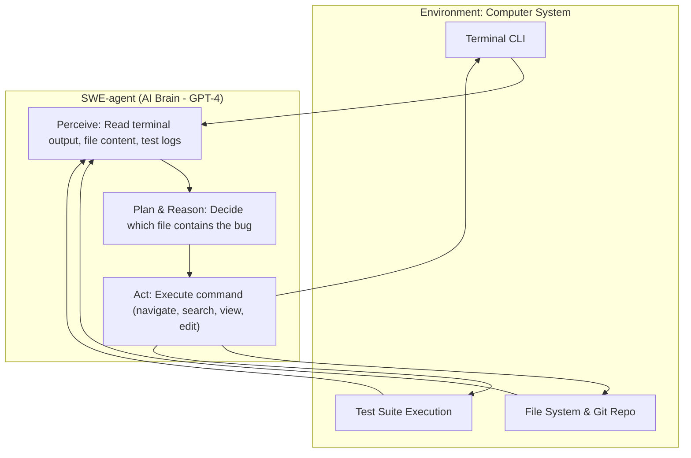
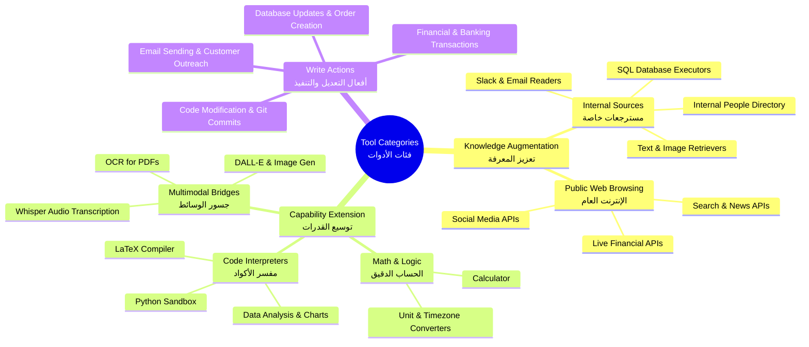

# الفصل 6 — الجزء 2: الوكلاء الأذكياء — الـ Agents (`ص 275–300`)

> **ملاحظة:** هذه الملاحظات شرح تفصيلي صفحة بصفحة بأسلوب شخصي بالعامية المصرية مع الحفاظ على المصطلحات التقنية بالإنجليزية. أرقام الصفحات مطابقة تماماً لترقيم الكتاب المطبوع.

<BatchQuickNav
  :batches="[
    { label: 'الدفعة 6', anchor: '#batch-6', pages: '275–281' },
    { label: 'الدفعة 7', anchor: '#batch-7', pages: '282–288' },
    { label: 'الدفعة 8', anchor: '#batch-8', pages: '288–293' },
    { label: 'الدفعة 9', anchor: '#batch-9', pages: '293–300' }
  ]"
/>

---

## الدفعة 6: مدخل الوكلاء الذاتيين والأدوات (`ص 275–281`) {#batch-6}

> **افتتاحية الجزء الثاني:** بعد أن انتهينا من استرجاع البيانات وبناء السياق (RAG)، ننتقل الآن إلى الأفق الأكبر والأكثر إثارة في هندسة الذكاء الاصطناعي: **الوكلاء الأذكياء (`AI Agents`)**. كيف يتحول الموديل من مجرد "شات بوت" يجيب على الأسئلة، إلى "كيان برمجى مستقل" يدرك بيئته، يمتلك أدواته الخاصة، ويؤتمت مهام معقدة في العالم الحقيقي نيابة عنا؟

---

### صفحة 275 — الهدف الأسمى للذكاء الاصطناعي (`The Ultimate Goal of AI`)

في نهاية صفحة 275، تفتح الكاتبة **Chip Huyen** الباب بتأكيد تاريخي مهم:
الكتاب الكلاسيكي الأشهر في تاريخ علوم الذكاء الاصطناعي للأستاذين **Stuart Russell** و **Peter Norvig** (*Artificial Intelligence: A Modern Approach - 1995*) يُعرّف أبحاث الذكاء الاصطناعي برمتها بأنها:
> *"The study and design of rational agents"*
> (دراسة وتصميم الوكلاء العقلانيين).

أي أن فكرة الـ **Agent** ليست "تريند" عابر ظهر مع ChatGPT، بل هي الغاية الكبرى والأصلية التي أُنشئ من أجلها علم الذكاء الاصطناعي منذ البداية!

#### ما الذي تغير اليوم؟
القدرات غير المسبوقة لـ **Foundation Models** الحديثة (فهم التعليمات، الاستدلال المنطقي، واستخراج المخرجات المنظمة) هي التي جعلت من الممكن لأول مرة بناء وكلاء أذكياء ذاتيي التشغيل (`Autonomous Intelligent Agents`) يقومون بأدوار:
- **المساعد الشخصي (`Assistant`):** حجز رحلات، إدارة التقويم، كتابة الرسائل.
- **زميل العمل (`Coworker`):** كتابة أكواد برمجية كاملة، إجراء أبحاث تسويقية، إدخال بيانات، وتحليل تقارير مالية.
- **المدرب (`Coach`):** تدريب المستخدمين على المقابلات الوظيفية، تعليم لغات، والتفاوض.

---

### صفحة 276 — ما هو الـ Agent تحديداً؟ البيئة والأفعال (`Environment & Actions`)

في الأوساط الهندسية، استخدم مصطلح "Agent" في سياقات كثيرة متباينة (Software Agent, User Agent, Conversational Agent, RL Agent). فما هو التعريف الصارم له؟

> [!TIP] التعريف المعياري للوكيل (`Agent Definition`)
> **الـ Agent هو أي كيان يدرك بيئته من خلال المستشعرات (`Perceives via Sensors`) ويتصرف في تلك البيئة من خلال المؤثرات/المحركات (`Acts via Actuators`).**
> وبالتالي، يتميز كل Agent بركنين لا ينفصلان:
> 1. **البيئة التي يعمل فيها (`Environment`):** يحددها الاستخدام المطلوب (`Use Case`).
> 2. **مجموعة الأفعال التي يستطيع القيام بها (`Set of Actions`).**

#### 1) البيئة تحدد الأفعال الممكنة
البيئة هي الملعب الذي يعيش فيه الوكيل:
- لو الـ Agent مصمم للعب الشطرنج أو Go أو Dota: فاللعبة وقواعدها هي بيئته، والأفعال المتاحة هي الحركات المشروعة داخل اللعبة فقط.
- لو الـ Agent روبوت طهي: المطبخ هو بيئته، والأفعال هي تقطيع الخضار وتشغيل الموقد.
- لو الـ Agent سيارة ذاتية القيادة (`Self-Driving Car`): شبكة الطرق والمشاة والإشارات هي بيئتها، والتوجيه والفرامل وزيادة السرعة هي أفعالها.
- لو الـ Agent مصمم لكشط الإنترنت (`Scrape documents`): فالإنترنت هو بيئته.

#### 2) علاقة التبعية المتبادلة بين البيئة والأدوات (`Environment-Tool Dependency`)
- **البيئة تحدد الأدوات المحتملة:** لا معنى لإعطاء وكيل الشطرنج أداة لتصفح الويب!
- **ترسانة الأدوات تقيّد بيئة الوكيل:** لو الروبوت كل أفعاله تنحصر في "السباحة"، فهو مقيد حتماً بالبيئات المائية (`Water Environment`) ولا يمكنه العمل على اليابسة.

#### 3) النماذج اليوم كـ Agents مبكرة
أغلب تطبيقات الـ GenAI التي نتعامل معها يومياً هي وكلاء (`Agents`) يمتلكون أدوات بسيطة:
- **ChatGPT هو Agent:** بيئته واجهة المحادثة + الإنترنت، وأفعاله هي البحث في الويب، تنفيذ كود بايثون، وتوليد الصور عبر DALL-E.
- **أنظمة الـ RAG هي Agents:** تمتلك أدوات استرجاع نصوص (`Text Retriever`)، صور (`Image Retriever`)، ومنفذ استعلامات (`SQL Executor`).

---

### صفحة 277 — دراسة حالة: عميل البرمجة `SWE-agent` وتدفق اتخاذ القرار

#### 1) عميل هندسة البرمجيات `SWE-agent` (Yang et al., 2024 — `Figure 6-8`)
يُعد **SWE-agent** (المبني فوق GPT-4) نموذجاً ساطعاً لكيفية تطبيق مفهوم الـ Agent في البرمجة:
- **بيئته (`Environment`):** جهاز الكمبيوتر بالكامل (شاشة الـ Terminal ونظام الملفات `File System`).
- **مجموعة أفعاله (`Actions / Tools`):**
  - تصفح المستودع البرمجي (`Navigate repo`).
  - البحث في الملفات والأكواد (`Search files`).
  - فتح واستعراض محتويات الملفات (`View files`).
  - تعديل واستبدال أسطر محددة في الكود (`Edit lines`).
  - تشغيل الاختبارات (`Run tests`).

#### 2) الـ AI هو العقل الموجه (`The Brain`)
في أي AI Agent، يلعب نموذج الذكاء الاصطناعي دور "المخ":
1. يستقبل مدخلات ومهمة المستخدم (`Task`).
2. يستقبل التغذية الراجعة والنتائج من البيئة (`Feedback / Tool Outputs`).
3. يخطط لسلسلة من الأفعال للوصول للهدف (`Plan sequence of actions`).
4. يُقيّم متى تم إنجاز المهمة بنجاح للتوقف (`Determine task completion`).

#### 3) مثال Kitty Vogue يتحول من RAG إلى Agent (سلسلة الـ 8 خطوات)
بالعودة لمتجر القطط الخيالي، لو دخل المدير وسأل سؤالاً استراتيجياً:
> **"توقع لي إيرادات مبيعات قبعة Fruity Fedora خلال الشهور الثلاثة القادمة؟"**
> *"Project the sales revenue for Fruity Fedora over the next three months."*

النظام هنا لا يكتفي باستعلام SQL واحد، بل ينفذ **سلسلة تفكير وتنفيذ ديناميكية** من 8 خطوات:
1. **التفكير (`Reasoning`):** الموديل يفكر أولاً: للتنبؤ بالمستقبل، أحتاج أرقام المبيعات التاريخية لآخر 5 سنوات.
2. **استدعاء أداة 1:** توليد استعلام SQL لجلب مبيعات السنوات الخمس الماضية.
3. **تنفيذ الأداة 1:** تشغيل استعلام الـ SQL واستخراج الأرقام.
4. **التفكير في النتيجة (`Reason on output`):** الموديل يلاحظ أن هناك شهوراً فيها أرقام ناقصة أو شاذة، فيقرر أنه بحاجة أيضاً لمعرفة مواعيد وميزانيات الحملات التسويقية السابقة.
5. **استدعاء أداة 2:** توليد استعلام SQL لجلب بيانات الحملات التسويقية.
6. **تنفيذ الأداة 2:** تشغيل الاستعلام.
7. **التفكير والدمج:** الموديل يرى أن المعلومات أصبحت كافية ومكتملة، فيجري عملية الحساب والتوقع المستقبلي.
8. **الإنهاء:** يقرر الموديل أن المهمة اكتملت ويقدم التقرير النهائي للمستخدم.

---

### صفحة 278 — لماذا تتطلب الـ Agents أقوى النماذج؟ (`Compound Mistakes`)

لماذا نستخدم دائماً أقوى النماذج المتاحة في السوق (مثل GPT-4o أو Claude 3.5 Sonnet) كعقول للـ Agents؟
تحدد Chip Huyen سببين جوهريين:

#### 1) خطورة الأخطاء التراكمية المركبة (`Compound Mistakes`)
في الشات العادي (خطوة واحدة)، لو دقة الموديل $95\%$ فالنتيجة ممتازة.
أما في الـ Agents، إنجاز المهمة يتطلب سلسلة خطوات متعاقبة ($n$ steps)، وكل خطوة تعتمد مخرجاتها على صحة الخطوة التي سبقتها.

رياضياً، إذا كانت دقة الموديل في الخطوة الواحدة هي $p = 0.95$:
- على مدى **10 خطوات**:
  $$\text{Accuracy}_{\text{overall}} = (0.95)^{10} \approx 0.5987 \quad (\approx 60\%)$$
- على مدى **20 خطوة**:
  $$\text{Accuracy}_{\text{overall}} = (0.95)^{20} \approx 0.3584 \quad (\approx 36\%)$$
- على مدى **100 خطوة**:
  $$\text{Accuracy}_{\text{overall}} = (0.95)^{100} \approx 0.0059 \quad (\approx 0.6\%)$$

> [!WARNING] قانون تناقص دقة الوكلاء
> مع زيادة عدد الخطوات، تنحدر الدقة الكلية للنظام بسرعة دراماتيكية! خطأ واحد صغير في الخطوة رقم 3 قد يقود الوكيل إلى تيه كامل وحلقات لا نهائية في الخطوات التالية؛ لذا يحتاج الوكيل لأعلى نماذج الاستدلال دقة وقدرة على التعافي الذاتي من الأخطاء.

#### 2) ارتفاع سقف المخاطر (`Higher Stakes`)
في الاستخدامات العادية، أقصى فشل هو نص غير دقيق في الشاشة. أما عندما يمتلك الوكيل أدوات حقيقية في بيئة عملك، فإن الفشل قد يعني:
- حذف جداول من قاعدة بيانات الإنتاج.
- إرسال بريد إلكتروني غير لائق لعملاء كبار.
- تحويل أموال لحسابات خاطئة.

#### تكلفة تشغيل الـ Agents
تتطلب مهام الوكلاء استدعاءات متكررة للموديل، مما قد يستهلك رصيد الـ API بسرعة (*"Agents are only good for burning through your API credits"* كما كان يُقال في البدايات). لكن إذا نجح الوكيل في العمل باستقلالية وموثوقية، فإن ما يوفره من آلاف الساعات البشرية يجعل تكلفة الـ API ضئيلة للغاية مقارنة بالقيمة الاقتصادية الناتجة.

---

### صفحة 278–279 — تصنيف الأدوات (`Tools`): تعزيز المعرفة والقدرات

الأدوات (`Tools`) هي الركيزة التي تمكّن الوكيل من **الإدراك (`Perceive - Read`)** و**الفعل (`Act - Write`)**.
مجموعة الأدوات المتاحة للوكيل تسمى **ترسانة أدواته (`Tool Inventory`)**.
تقسم Chip Huyen الأدوات إلى **ثلاث فئات رئيسية**:

---

#### 1) أدوات تعزيز المعرفة (`Knowledge Augmentation`)
هدفها تزويد الموديل بالسياق والمعلومات الدقيقة قبل اتخاذ القرار:
- **أدوات المؤسسة الداخلية:** مسترجعات نصوص، صور، جداول مبيعات SQL، رسائل Slack، بريد إلكتروني، ودليل موظفي الشركة (`Internal People Search`).
- **تصفح الإنترنت (`Web Browsing`):**
  - يمنع النموذج من أن يصبح قديماً متقادماً (**Prevents a model from going stale**).
  - إذا انتهت بيانات تدريب النموذج الأسبوع الماضي، فلن يعرف شيئاً عن أحداث اليوم أو أسعار الأسهم أو حالة الطقس أو تذاكر الطيران إلا عبر تصفح الويب واستدعاء APIs البحث الحية (Search APIs, News, GitHub, Reddit).
  - **تنبيه أمني وبياناتي:** كما يمنح الويب الموديل معلومات حية، فإنه قد يعرضه لمستنقعات الإنترنت والمعلومات المضللة والمسمومة؛ لذا يجب انتقاء مصادر البيانات الخارجية بحذر.

---

### صفحة 279–280 — توسيع القدرات (`Capability Extension`) ومفسر الأكواد

#### 2) أدوات توسيع القدرات الذاتية (`Capability Extension`)
تعالج هذه الأدوات نقاط الضعف الفطرية في النماذج اللغوية، وتمنحها دفعة أداء هائلة دون الحاجة لإعادة تدريبها:

##### أ) الأدوات الحسابية البسيطة:
النماذج اللغوية سيئة بطبيعتها في الحسابات الحسابية الصارمة (مثلاً: ما حاصل قسمة $199,999 \div 292$؟).
- بدلاً من إهدار ملايين الدولارات لتدريب الموديل على الحساب، من الأوفر والأذكى بكثير منحه **آلة حاسبة (`Calculator`)**.
- أدوات بسيطة تصنع فارقاً خارقاً: التقويم (`Calendar`)، محول المناطق الزمنية (`Timezone Converter`)، ومحول الوحدات (`Unit Converter` من رطل لكيلوجرام).

##### ب) مفسر الأكواد (`Code Interpreters`):
أحد أقوى الأسلحة في يد الوكيل الذكي:
- بدلاً من أن يخمّن الموديل ناتج كود في رأسه، يكتب كود بايثون ويرسله لمفسر الأكواد، فيتم تنفيذه داخل Sandbox آمن، وتعود النتيجة الرقمية أو رسالة الخطأ للموديل ليتعلم منها ويصلح كوده.
- يتيح هذا للوكلاء العمل كمساعدي برمجة، محللي بيانات (`Data Analysts`)، وباحثين علميين يجرون التجارب ويرسمون المخططات البيانية.
- **تنبيه أمني حاسم:** التنفيذ الآلي للكود ينطوي على مخاطر **هجمات حقن الأكواد (`Code Injection`)**؛ لذا يُشترط تشغيله في بيئات معزولة تماماً (`Sandboxed Containers`) بصلاحيات محدودة جداً.

##### ج) جسور الوسائط المتعددة (`Multimodal Bridges`):
الأدوات تجعل الموديل أحادي الوسائط (نصي فقط) يعمل كنظام متعدد الوسائط:
- نموذج نصي يستدعي `DALL-E` لتوليد صور.
- نموذج نصي يستدعي `Matplotlib` لرسم شارتات، أو `LaTeX` لكتابة معادلات، أو متصفحاً لعرض كود `HTML`.
- نموذج نصي يستدعي أداة `OCR` لقراءة الـ PDFs، أو أداة `Audio Transcription` لسماع الصوتيات.

##### د) إثبات تجريبي: نموذج `Chameleon` (Lu et al., 2023)
ورقة بحثية رائدة أثبتت أن تزويد GPT-4 بـ 13 أداة (توليد استعلامات، استرجاع نصوص، كشف صور، وبحث Bing) تفوق على GPT-4 بمفرده تفوقاً كاسحاً:
- في اختبار **ScienceQA** للأسئلة العلمية: تحسنت الدقة بمقدار **$+11.37\%$**.
- في اختبار **TabMWP** للمسائل الرياضية الجدولية: تحسنت الدقة بمقدار **$+17\%$**.

---

### صفحة 280–281 — أفعال الكتابة والتعديل (`Write Actions`) وإشكالية الأمان

#### 3) أفعال الكتابة والتعديل في العالم الحقيقي (`Write Actions`)
حتى هذه اللحظة، ركزنا على أفعال "القراءة فقط" (`Read-only`). لكن القوة الكاملة للوكيل تتفجر عندما يمتلك القدرة على **إحداث تغيير حقيقي في البيئة (`Write Actions`)**:
- استعلام الـ SQL يمكنه قراءة جدول، لكن يمكنه أيضاً تعديل صفوفه أو حذفه.
- واجهة البريد الإلكتروني تقرأ الرسائل الواردة، لكنها تستطيع أيضاً إرسال الردود.
- واجهة البنك تقرأ الرصيد، لكنها تستطيع أيضاً تنفيذ تحويلات مالية وسحب أموال.

#### أتمتة دورات الأعمال بالكامل (`End-to-End Automation`)
أفعال الكتابة تسمح لك بأتمتة دورة عمل كاملة لمسؤولي المبيعات (`Sales Outreach`):
1. البحث عن عملاء محتملين في الويب.
2. استخراج بيانات التواصل والتأكد منها.
3. صياغة الإيميل الأول وتخصيصه لكل عميل.
4. إرسال الإيميل وقراءة الردود الواردة.
5. المتابعة التلقائية وتحديث قاعدة البيانات بالطلبات المؤكدة.

#### إشكالية الأمان والثقة (`Trust, Safety & Security`)
لكن إعطاء الذكاء الاصطناعي صلاحية تعديل العالم الحقيقي يثير مخاوف حقيقية:
> [!CAUTION] حكمة إدارية وهندسية
> كما أنك لا تمنح متدرباً جديداً في أسبوعه الأول صلاحية الدخول ومسح قاعدة بيانات الإنتاج (`Production DB`)، لا ينبغي أبداً منح وكيل ذكاء اصطناعي غير موثوق الصلاحية المطلقة لإجراء تحويلات بنكية أو حذف ملفات حساسة.
> الثقة تُبنى بالتجربة، وبالضوابط الأمنية الصارمة (`Guardrails & Permissions`).

تستشهد الكاتبة بنقاشات السيارات ذاتية القيادة: الخوف من القرصنة موجود، لكن في الواقع أجهزة الذكاء الاصطناعي قادرة على إلحاق ضرر واسع دون وجود جسدي مادي (التلاعب بالبورصة، سرقة الملكية الفكرية، انتهاك الخصوصية، وترويج الشائعات). ومع تطور معايير الأمان، سنصل إلى درجة ثقة كافية تجعل فوائد الوكلاء تعم العالم، تماماً كما وثق البشر في الآلات التي تنقلهم للفضاء.

#### استدعاء الدوال (`Function Calling`)
دعمت كبرى شركات النماذج هذه الرؤية رسمياً من خلال خاصية **Function Calling**، حيث يحدد المطور أدواته بصيغة `JSON Schema`، ويقرر الموديل متى يستدعي الأداة، وما هي المعاملات (`Arguments`) المطلوبة بدقة متناهية.

---

<QuickFlashcards
  title="مراجعة سريعة — الدفعة 6 (ص 275–281)"
  :cards="[
    {
      q: 'ما هو تعريف الوكيل العقلاني (Rational Agent) وفقاً لكتاب Russell & Norvig؟',
      a: 'هو أي كيان يدرك بيئته المحيطة من خلال المستشعرات (Sensors) ويتصرف في تلك البيئة من خلال المؤثرات والمحركات (Actuators).'
    },
    {
      q: 'لماذا تنحدر دقة الوكلاء بسرعة عند زيادة عدد الخطوات (Compound Mistakes)؟',
      a: 'لأن احتمالية النجاح الكلي هي حاصل ضرب دقة كل خطوة على حدة: فإذا كانت دقة الخطوة 95%، فإن الدقة الإجمالية تنخفض إلى 60% بعد 10 خطوات، وإلى 0.6% بعد 100 خطوة.'
    },
    {
      q: 'ما هي الفئات الثلاث الرئيسية للأدوات في ترسانة الوكيل (Tool Inventory)؟',
      a: '1) تعزيز المعرفة (Knowledge Augmentation مثل RAG وتصفح الويب)، 2) توسيع القدرات (Capability Extension مثل الآلة الحاسبة ومفسر بايثون)، 3) أفعال الكتابة والتنفيذ (Write Actions مثل إرسال الإيميلات وتعديل قواعد البيانات).'
    },
    {
      q: 'كيف ساعدت ترسانة الأدوات نموذج Chameleon على التفوق على GPT-4 الأصلي؟',
      a: 'من خلال تزويده بـ 13 أداة خارجية (بحث، حساب، كشف صور)، مما رفع دقته بنسبة +11.37% في الأسئلة العلمية ScienceQA، وبنسبة +17% في المسائل الرياضية الجدولية TabMWP.'
    },
    {
      q: 'ما هو الخطر الرئيسي المصاحب لأفعال الكتابة (Write Actions) وكيف يتم التعامل معه؟',
      a: 'الخطر هو إحداث تغييرات كارثية غير قابلة للإلغاء في العالم الحقيقي (حذف بيانات، تحويل أموال)؛ ويتم التعامل معه عبر بيئات معزولة (Sandboxes)، ضوابط صلاحيات دقيقة، وحواجز أمان (Guardrails).'
    }
  ]"
/>

<BatchCheck id="ch06-b6" label="الدفعة 6 (ص 275–281): Agent Overview & Tools (SWE-agent, Compound Mistakes, Tool Inventory, Write Actions)" />
